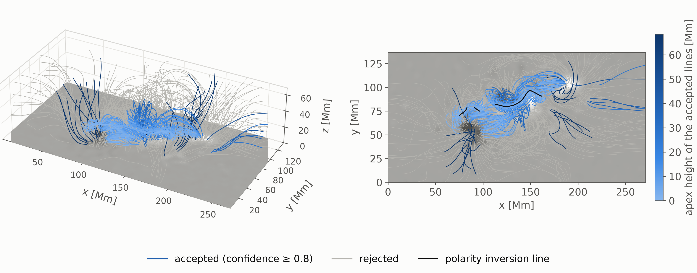
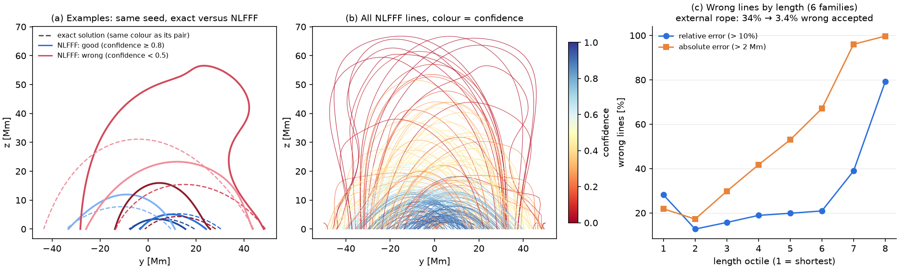

# Per-line confidence

Every traced line gets a confidence between 0 and 1, defined as one minus the estimated probability
that the line is wrong. A line is *wrong* when its mean distance to the true line traced from the same
seed exceeds 10 % of the length, or when one of the two is open and the other closed.

## Usage

```python
import solarff as sff

mag = sff.load_sharp_cea("data/harp377", rebin=4).balance_flux()
nl = sff.nlfff_lbfgs(sff.preprocess(mag), nz=48)

seeds = sff.seeds_from_magnetogram(mag, n=300)
lines = sff.trace_field_lines(nl, seeds)

a = sff.assess_lines(nl, lines, mag=mag)
a["confidence"]      # one value per line
a["reliable"]        # boolean mask: confidence >= 0.8
a["indicators"]      # the indicators the confidence is computed from
```

Two more helpers build on it:

```python
cm = sff.confidence_map(nl, mag=mag, step=2)            # confidence of the line leaving each pixel
vol = sff.reliable_volume(nl, lines, a["reliable"])     # 3D mask of cells threaded by reliable lines
```



## How it was calibrated

- **Training set:** six families of exact force-free fields (three Low & Lou variants, two exact
  linear fields and a relaxed Titov–Démoulin flux rope), three noise models, three grid sizes and
  boxes of four proportions (the standard one, two flat ones and a tall one).
  That is 162 extrapolations and 48 062 lines whose true error is known.
- **Model:** a logistic regression with five terms: the variation of α along the line, the fraction
  of the line in the boundary layer, and the logarithm of the length relative to the horizontal
  diagonal of the box, its square, and the logarithm of the length relative to the height of the
  box. No more complex classifier does better.
- **Why the height of the box:** a model fitted in boxes of one proportion accepts 8 to 11 % of wrong
  lines in boxes as flat as those of real regions. With the last term the figure is 4 to 6 % in
  every box, also in boxes left out of the fit. In four external families the term halves the wrong
  lines accepted in flat boxes, but it does not even them out: an external flux rope stays at 10 %
  there, against 3 % in the standard box, and in a tall box the term accepts 2 to 5 points more than
  the four terms. The model of version 1.1, without that term, is kept as
  `solarff.confidence.CALIBRATION_V1`.
- **Validation:** leaving out one whole family at a time, so the model is always tested on a
  geometry it has not seen.

| Threshold | Lines accepted | Wrong among the accepted |
|---|---|---|
| 0.7 | 62 % | 8.4 % |
| **0.8 (default)** | 51 % | 4.4 % |
| 0.9 | 37 % | 1.5 % |

On an independent flux rope that was never used for training, the wrong lines among the accepted
ones drop from 34 % to 3 %.



## Applying it to your own extrapolation

1. **Use the same code and the same preprocessing.** The preprocessing is the critical choice: with
   other parameters the confidence degrades and does not notice.
2. **Check the range of the extrapolation.** The mean current-weighted angle `CWsin` should be within
   0.04–0.21, the divergence energy fraction `E_div/E` within 0.006–0.24 and the boundary weight
   within 0.03–0.48. Outside these ranges, do not use the published probability.
3. **Pick the threshold for your use.** Use 0.9 if almost no accepted line may be wrong, 0.7 to keep
   more lines.
4. **Report results on reliable lines too.** If a per-line quantity changes when restricted to
   reliable lines, say by how much.
5. **Do not attribute energy to a zone of the volume** without repeating the calculation with
   different seed densities, dilations and thresholds.
6. **With another NLFFF code, recalibrate** with the same procedure
   (`examples/04_calibration_suite.py`).

!!! warning "Read it as a conditional score"
    Passing the range checks is necessary, not sufficient. For real magnetograms the confidence is a
    conditional reliability score, not a guaranteed error probability. Within one region, use it
    above all to rank lines.

## Known limits

- **Optimistic cases that nothing flags.** On four external families the ranking holds (AUC 0.86–0.95),
  but in two of them 18–21 % of the accepted lines are wrong. Their wrong lines look like good ones to the
  indicators, and no global quantity of the extrapolation warns of it. A high failure rate is not the
  criterion: another external family fails on a similar fraction of lines and its accepted set stays clean.
- **Systematic errors in the magnetogram.** A scale error of ±30 % in the transverse field, or taking
  it one cell higher than the vertical field, barely changes the result. A systematic rotation of the
  azimuth does: at about 5° or more the probability becomes optimistic, and at 10° the ranking
  degrades as well. The force and torque balance of the magnetogram (Aly criteria) does not reveal it.
- **Idealised training fields.** The calibration fields have an exactly force-free photosphere. Real
  photospheres do not. On exact fields built on the observed flux of three regions, and on the
  models of those regions taken as the truth, the ranking holds (AUC 0.76–0.93) but the accepted
  lines are wrong about twice as often as in the calibration suite (median 9 %, up to 25 %).
- **Resolution.** The extrapolations of real regions are not converged. With half the pixel, more
  than half of the accepted lines move by more than 10 % of their length and the free energy
  changes by up to 26 %. The confidence ranks the lines by how little they depend on the resolution
  and on the unobserved boundaries, but an accepted line is not thereby a converged one.
- **One code.** The published coefficients are valid for the solver in this library.

The coefficients are in `solarff.confidence.DEFAULT_CALIBRATION`. The full analysis is in the
associated paper.
