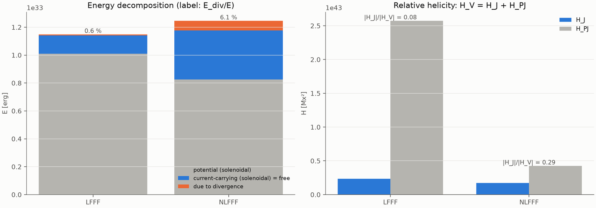
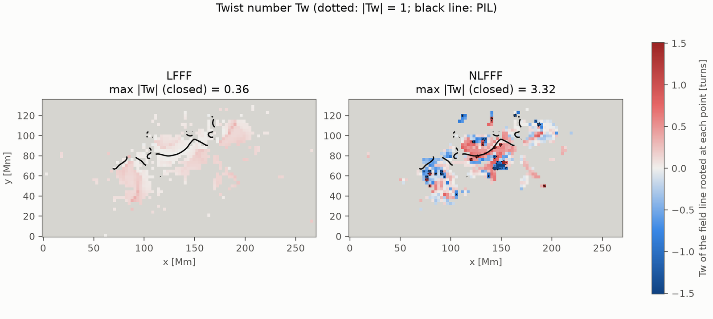
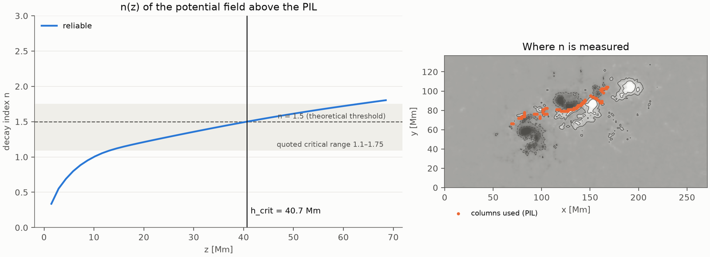
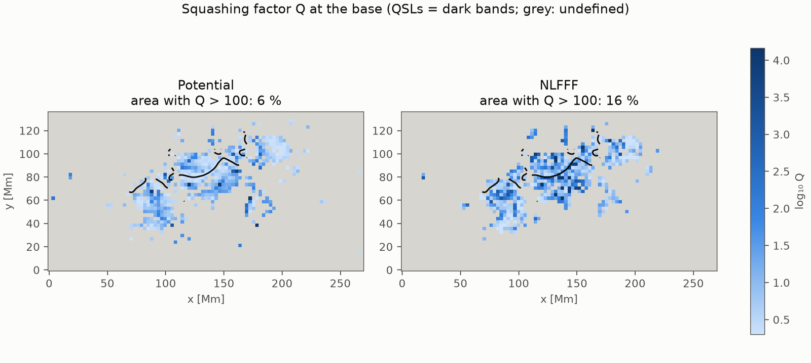
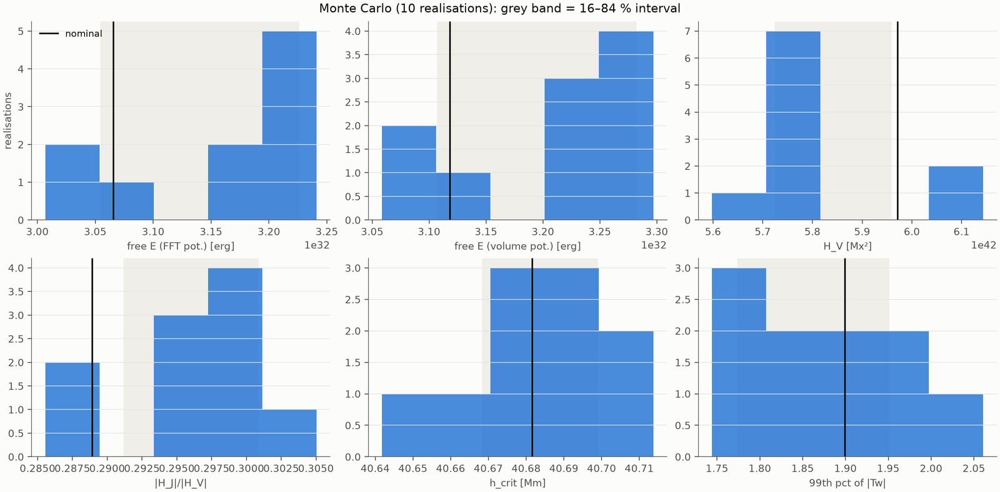
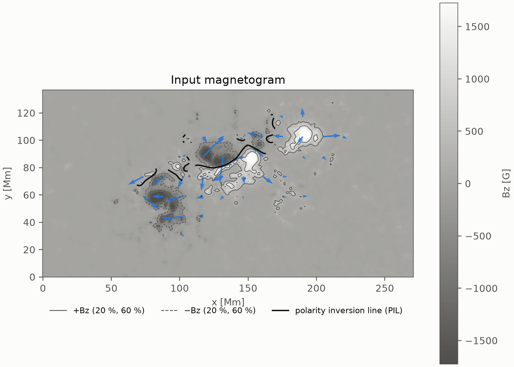
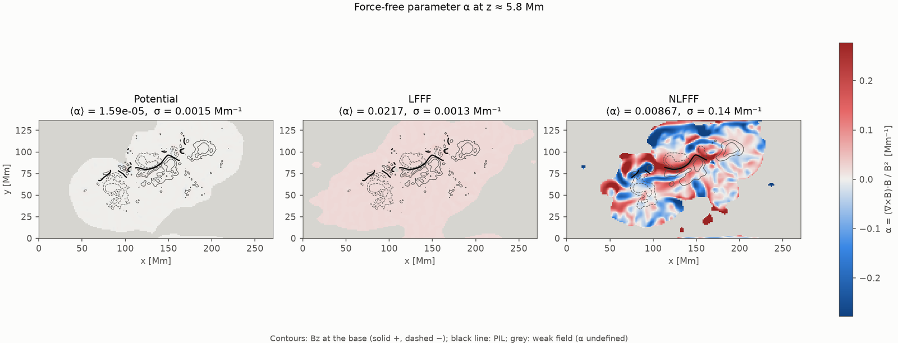
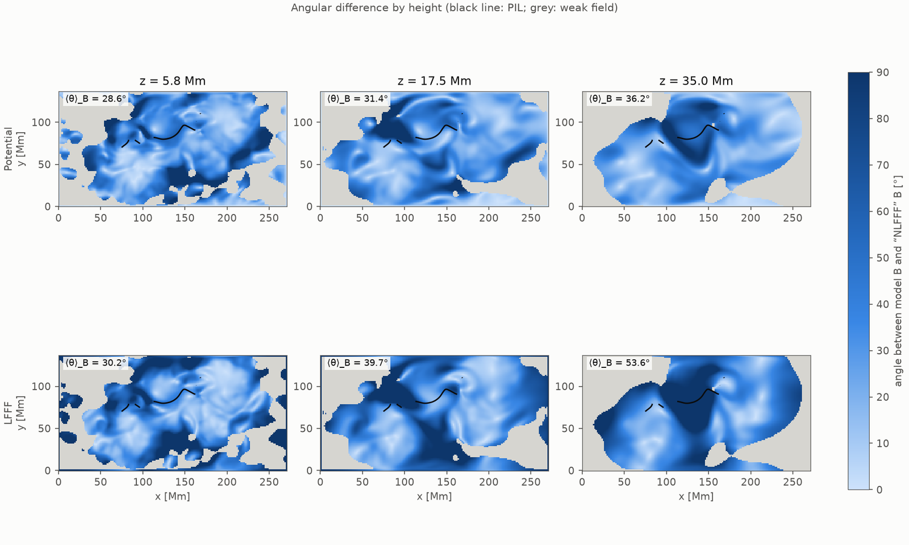

# Diagnostics

## Energy and helicity

```python
rep = sff.helicity_report(nl)
```

`helicity_report` computes, for a 3D field:

- the potential field with the same normal flux on the **six faces** of the box;
- the energy decomposition of Valori et al. (2013), where `E_div/E` measures how much energy is
  spurious because of the residual divergence;
- the relative helicity in the DeVore gauge with two references, whose difference is the numerical
  error of the helicity.

The free energy can be defined as the difference with the potential field (E − E_p) or as the energy
of the current-carrying part (E_J). They differ by 4–19 % in the regions studied, so always state
which one you quote.



## Is the region eruptive?

*Diagnostics of eruptivity. **Function**: the call in the library. **What it computes**: the quantity and its reference. **Usual threshold**: the value commonly taken as the sign of a flux rope, an instability or a separatrix layer.*

| Function | What it computes | Usual threshold |
|---|---|---|
| `twist_map(field)`, `twist_number(field, lines)` | twist number Tw of each line (Berger & Prior 2006; Liu et al. 2016) | abs(Tw) ≳ 1: flux rope |
| `decay_index_profile(pot)` | decay index n(z) of the potential field above the inversion line, and the critical height (Kliem & Török 2006) | n ≥ 1.5: torus unstable |
| `squashing_q(field)` | squashing factor Q at the base (Titov et al. 2002; Pariat & Démoulin 2012) | Q ≫ 2: quasi-separatrix layer |

For the decay index, compute the potential field with `pad=2`. The periodic copies of the Fourier
solution distort the decay with height otherwise.







*Twist, decay index and squashing factor of NOAA 11158. Each one is explained in
[Energy and eruptivity](getting-started/energy-eruptivity.md).*

## Uncertainties: Monte Carlo with the HMI errors

```python
mag = sff.load_sharp_cea("data/harp377", rebin=4).balance_flux()    # also reads the *_err segments
study = sff.run_study(mag, nz=48)
mc = sff.monte_carlo(study, n=10)
sff.generate_report(study, "docs/informes/my_region", monte_carlo=mc)
```

The preprocessing and the NLFFF are repeated with noise drawn from the HMI error maps. The result is
the median and the 16–84 % interval of the free energy, the helicity, the critical height and the
twist.

!!! warning "These are lower bounds"
    The Monte Carlo errors include neither systematic errors, nor ambiguity-resolution errors, nor
    the dependence on the extrapolation method.



## Comparing models

*Metrics printed by `compare_models`. **Metric**: its name in the table. **What it measures**: the property of the model. **Ideal**: the value of a perfect model; a dash where there is none.*

| Metric | What it measures | Ideal |
|---|---|---|
| `CWsin`, `theta_J_deg` | mean angle between J and B, weighted by the current | 0 |
| `<abs(f_i)>` | divergence (non-solenoidal flux per cell) | 0 |
| `E/E_pot`, `E_free` | energy relative to the potential field; free energy | — |
| `C_vec`, `C_CS` | vector and Cauchy–Schwarz correlation with the reference | 1 |
| `E'_n`, `E'_m` | 1 − normalised / mean vector error | 1 |
| `same_topology`, `endpoint_dist_Mm` | connectivity of the lines traced from the same seeds | 1, 0 |

```python
sff.print_table(sff.compare_models(models, reference="NLFFF", seeds=seeds, margin=nl.meta["nd"]))
```

Use `margin=nd` to exclude the boundary layer of the NLFFF from the comparison.

## Analytical validation

`sff.run_validation()` checks every tool against an exact solution:

*Checks of `run_validation`. **Tool**: what is tested. **Analytical case**: the field with a known answer. **Typical error**: how far the library is from that answer.*

| Tool | Analytical case | Typical error |
|---|---|---|
| Potential field | buried dipole | 1 − C_vec ≈ 10⁻⁴ |
| LFFF | residual of ∇×B = αB | about 1 % |
| NLFFF | Low & Lou (1990) | 1 − C_vec ≈ 0.01 |
| Twist | Gold & Hoyle (1960) tube | 0.6 % |
| Critical height | buried dipole | 0.3 % |
| Q | hyperbolic field | < 0.01 % |

On the Low & Lou benchmark (n = m = 1, 48×48×32 grid) the three models compare as follows:

*Three models of the Low & Lou field against the exact one; bold marks the best. **C_vec**: vector correlation with the exact field (1 is perfect). **E / E_exact**: energy over the exact energy (1 is perfect). **same topology**: fraction of lines from the same seed that join the same polarities as the exact ones.*

| | Potential | LFFF | NLFFF |
|---|---|---|---|
| C_vec | 0.851 | 0.930 | **0.990** |
| E / E_exact | 0.79 | 1.08 | **0.97** |
| same topology | 0.74 | 0.87 | **0.90** |

## Figures

*Plotting functions. **Function**: the call. **What it shows**: what the figure contains.*

| Function | What it shows |
|---|---|
| `plot_magnetogram(mag)` | $B_z$ with polarity contours, the inversion line and the transverse field |
| `plot_comparison(models, seeds)` | lines in 3D, top and side views, coloured by maximum height |
| `plot_comparison(..., color_by="seed")` | numbered seeds, to compare connectivity between models |
| `plot_alpha_maps(models, z)` | α on a horizontal slice |
| `plot_alpha_histogram(models, seeds)` | mean α of each line and its variation along it |
| `plot_error_maps(models, reference, heights)` | angle between each model and a reference at several heights |







*`plot_magnetogram`, `plot_alpha_maps` and `plot_error_maps` on NOAA 11158.*

### Interactive 3D view

[Try it with three active regions](view3d.md).

`tools/lines3d.py` writes a single HTML page with every line traced from the base of one or more regions. The page
draws the lines in 3D over the magnetogram. They can be coloured by apex height, by confidence or by the confidence
model that accepts them, and hovering over a line shows its confidence. The horizontal field can be added as arrows:
that of the magnetogram, the preprocessed one, or the extrapolated one at any height. The page works offline and its
interface is in English or Spanish.

```bash
python tools/lines3d.py my_study.pkl -o my_region.html    # a pickled Study with an NLFFF extrapolation
python tools/lines3d.py --lang es                         # the three regions of the paper
```

The lines are traced as in the paper: seeds every two pixels in x and in y where $|B_z|$ exceeds 5 % of its maximum
(`--every 1` seeds every pixel). The first run downloads three.js r147 into `data/` and checks its SHA-256.

## Noise bias

Noise shifts some quantities systematically, so the Monte Carlo median does not match the nominal
value. A bootstrap correction was tested on exact fields (`examples/05_bias_validation.py`). It helps
with isotropic noise but makes things worse with HMI-like noise, where the transverse noise is much
larger than the vertical one. It is therefore not applied, and the bias is reported as a systematic
uncertainty. The free energy relative to the volume potential and the helicity are much more robust
to noise.

## Known limitations

- **LFFF.** Periodic lateral boundaries, and abs(α) must stay below 2π/L. A single α does not
  represent regions with localised currents.
- **NLFFF.** The side and top faces are fixed to the potential field, so results are reliable only
  away from them. Grids above about 128³ are slow.
- **Geometry.** Cartesian, with no curvature, valid for regions up to about 200–300 Mm.
- **Uncertainties.** The Monte Carlo errors are lower bounds: they exclude systematic errors and the
  dependence on the method.
