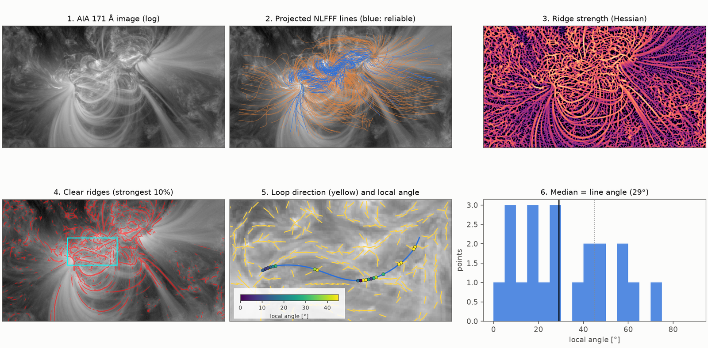
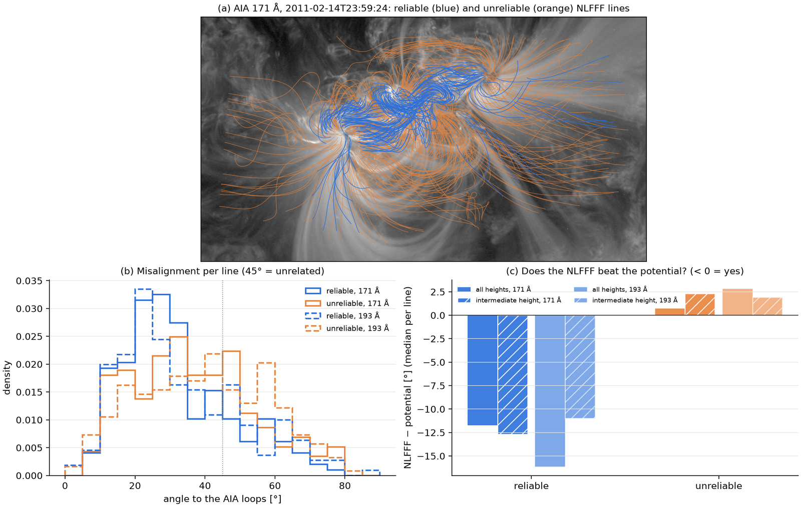

# Comparison with AIA loops

The coronal loops seen in extreme ultraviolet trace the magnetic field. Projecting the lines of the
model onto an AIA image and measuring the angle with the loops is an independent check of the
extrapolation, and one of the few available for a real region. It needs the extra `aia`.

## 1. Lines and their confidence

```python
import numpy as np
import solarff as sff
from solarff.aia import aia_validation, download_aia

cm = sff.confidence_map(study.nlfff, mag=study.mag_pp, step=2)
lines = cm["lines"]
seeds = np.array([l.seed for l in lines])
other = {"potential": sff.trace_field_lines(study.potential, seeds)}     # same seeds, another model
```

`study` is the result of [`run_study`](study-report.md). The lines of other models must start from
the same seeds, so the comparison is line by line.

## 2. The AIA images

```python
files = download_aia("2011-02-14T23:59:19.75Z", (171, 193), email="you@example.org")
```

- The time is in **UTC**, while the HMI times are in TAI: in 2011, TAI − UTC = 34 s.
- `download_aia` takes the level-1 image of quality 0 closest in time, within `window` (2 minutes by
  default), for each wavelength. It returns `{wavelength: path}` and does not download a file twice.
- 171 Å and 193 Å show loops of about 1 and 1.5 MK, the temperatures of most active-region loops.

## 3. The comparison

```python
sharp = "data/harp377/hmi.sharp_cea_720s.377.20110215_000000_TAI.Br.fits"
res = aia_validation(lines, cm["assess"]["confidence"], cm["assess"]["reliable"], files, sharp, other)
res["summary"]
```

`sharp` is any segment of the SHARP: its header gives the projection from the model box to the solar
disc.



*The steps of the measurement. (1) AIA image in logarithmic scale. (2) Lines of the model projected
onto it. (3) Ridge strength from the Hessian of the image. (4) The clearest 10 % of the ridges, taken
as loops. (5) The direction of each loop and the angle with the line that crosses it. (6) The angle
of each line is the median over its points on loops.*

*Parameters of `aia_validation`. **Parameter**: its name. **Default**: its value if not given. **What it does**: its effect on the measurement.*

| Parameter | Default | What it does |
|---|---|---|
| `sigma` | 2 | smoothing of the image, in AIA pixels, before finding the ridges |
| `pct` | 90 | only ridges stronger than this percentile count as loops |
| `n_boot` | 2000 | bootstrap resamplings for the intervals |
| `other_lines` | `None` | lines of other models from the same seeds |



*Top: reliable NLFFF lines in blue and unreliable ones in orange over AIA 171 Å. Bottom: distribution
of the angle with the loops, and the comparison with the potential field at the same seeds.*

!!! note "How to read the result"
    - Reliable lines tend to be low, and low lines are easier to align. The summary repeats the
      comparison at equal height, by terciles of the apex, and that is the fair figure.
    - A smaller angle supports the model but does not prove it: a 2D projection cannot tell the
      height of a loop, and several loops overlap along the line of sight.
    - With a crowded image, differences between two good models can disappear. See
      [What an image of loops can say](../realistic.md#what-an-image-of-loops-can-say).

## In the report

Pass the result to the report and it adds a section with these figures:

```python
sff.generate_report(study, "reports/noaa11158", aia=res)
```

`examples/08_aia_validation.py` runs the whole comparison for a cached study.
