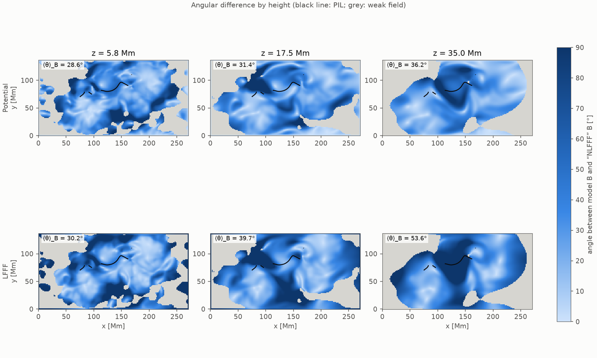
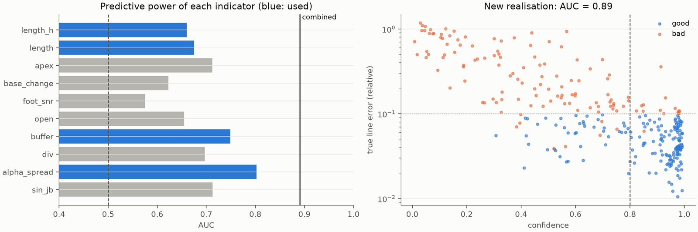
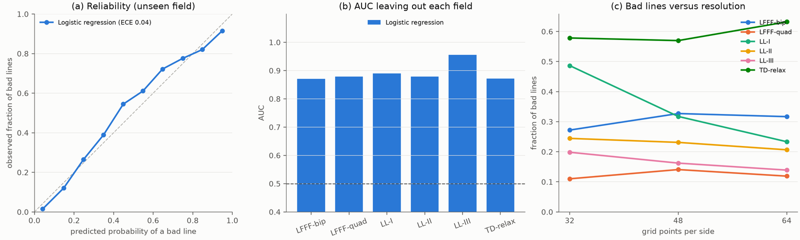

# Benchmarks and simulations

To know how well a method works you need a field whose answer is known. `solarff` has two kinds:
exact analytical fields, and radiative MHD simulations taken as the truth.

## Analytical fields

```python
from solarff import analytic

exact = analytic.low_lou_field(nx=48, ny=48, nz=32, l=0.3, phi=0.785)    # Low & Lou (1990)
rope = analytic.titov_demoulin_field(nx=48, ny=48, nz=32)                # flux rope, Titov & Démoulin (1999)
mhs = analytic.mhs_multipole_field(nx=48, ny=48, nz=32)                  # magnetohydrostatic, Low (1991)

mag = analytic.field_magnetogram(exact, noise=10.0, noise_t=60.0, rng=1)  # its base, with noise
nl = sff.nlfff_lbfgs(sff.preprocess(mag), nz=32)
sff.print_table(sff.compare_models({"Exact": exact, "NLFFF": nl}, reference="Exact"))
```

- `field_magnetogram` takes the base of any 3D field and adds Gaussian noise: `noise` in $B_z$ and
  `noise_t` in the transverse field, in G. The HMI-like model of the calibration is 10 and 60 G.
- `analytic.CALIBRATION_FIELDS` and `analytic.EXTERNAL_TEST_FIELDS` hold the families used to
  calibrate and to test the confidence. Each entry is a function of `(nx, ny, nz)`:

```python
for name, build in analytic.CALIBRATION_FIELDS.items():
    exact = build(48, 48, 32)
```



*`plot_error_maps`: the angle between each model and a reference at three heights. In this report of
NOAA 11158 the reference is the NLFFF; in a benchmark it is the exact field.*

## Calibrating the confidence again

With another NLFFF code, or another preprocessing, the published coefficients do not apply.
`examples/04_calibration_suite.py` runs the calibration suite: 162 extrapolations of exact fields with
three noise models, three sizes and four box proportions.



*Left: how well each indicator alone separates wrong lines, measured by its AUC; the blue ones enter
the model. Right: error of each line against its confidence in a new realisation.*



*(a) Predicted against observed probability of a wrong line, fitting without the family tested.
(b) AUC for each family left out. (c) Wrong lines against resolution.*

## MHD simulations as the truth

```python
from solarff import simulations

truth = simulations.reduced_field("ar098192", 290000, r=8, raw="data/muram")   # MURaM active region
mag = analytic.field_magnetogram(truth, noise=10.0, noise_t=60.0, rng=1)
nl = sff.nlfff_lbfgs(sff.preprocess(mag), nz=truth.shape[2])
```

*Arguments of `simulations.reduced_field`. **Parameter**: its name. **What it does**: its meaning and the values it takes.*

| Parameter | What it does |
|---|---|
| `sim`, `snap` | run and snapshot of the [Oslo catalogue](https://sdc.uio.no/search/simulations): `"ar098192"` (MURaM active region), `"qs024048_by3363"` and `"en024048_hion"` (Bifrost) |
| `r` | pixels of the simulation per cell; 8 gives 1.54 Mm for the active region |
| `raw` | folder of the raw cubes; they are downloaded there on first use, and they are large |
| `z0` | height of the base in Mm; 0 is the photosphere, 1.5 a chromospheric base |

`solarff.simulations.SIMULATIONS` lists the runs with their references. What these tests found, and
the scripts that ran them, are in [Tests against simulations](../realistic.md).

## Quick self-test

```python
sff.run_validation(quick=True)       # the analytical tests of the diagnostics, in seconds
```

```bash
pytest                               # the full test suite, about three minutes
```
