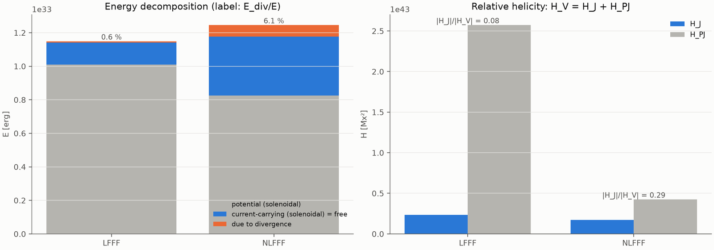
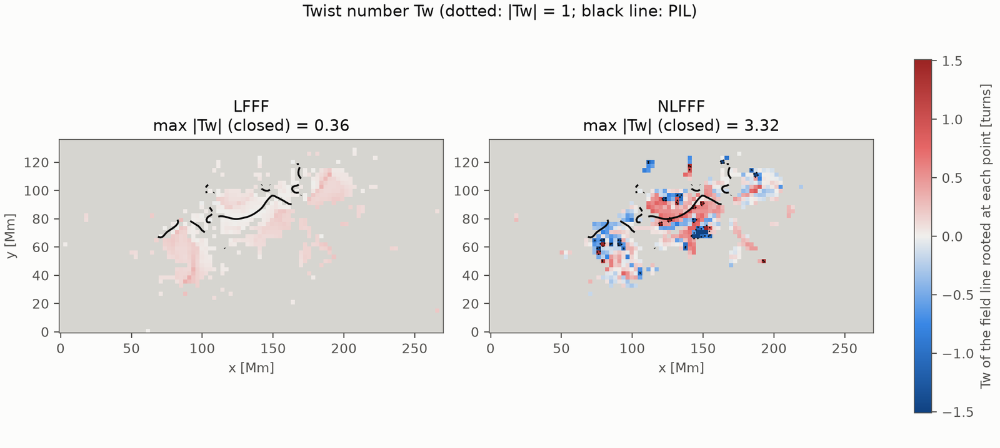
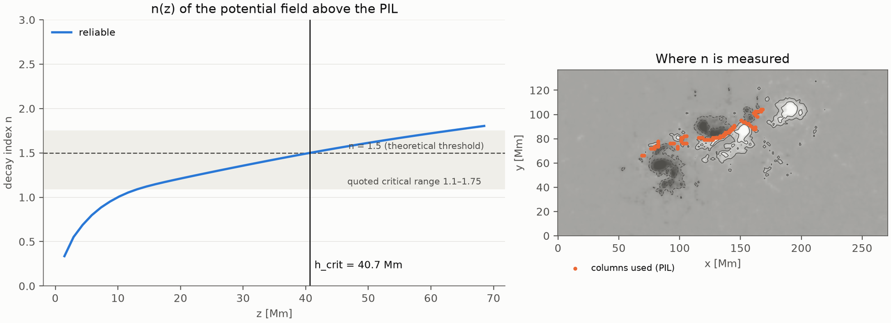
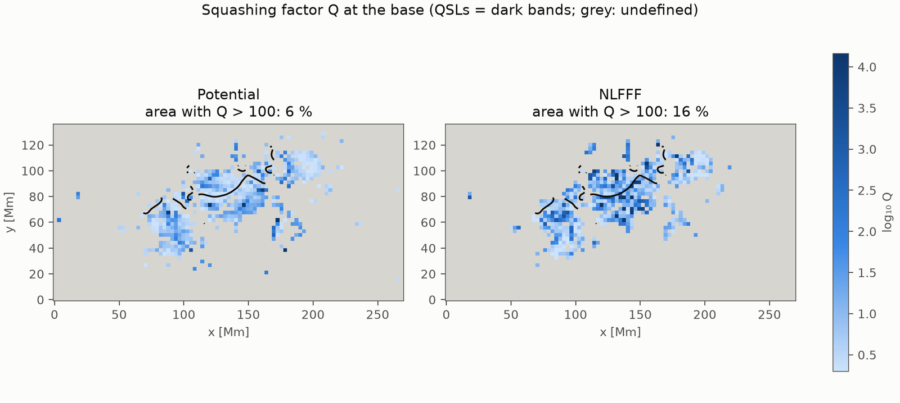
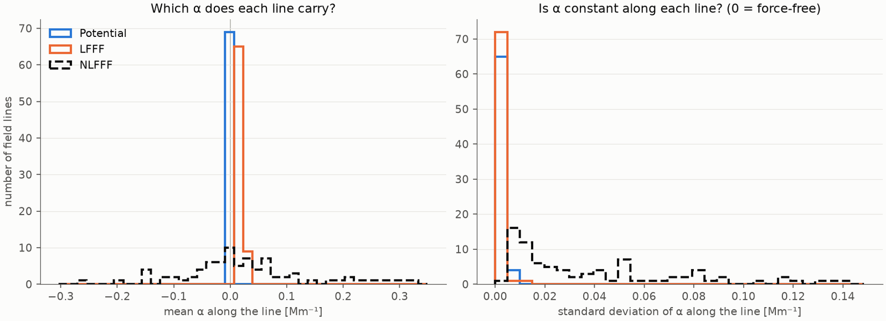

# Energy and eruptivity

How much energy can the region release, and is it close to erupting? This page computes the usual
answers from an extrapolation. It starts from the models `pot` and `nl` of
[An HMI active region](hmi-region.md). The equations are in [Method](../method.md#step-5-energy-helicity-and-topology).

## Energy and helicity

```python
rep = sff.helicity_report(nl)
e, h = rep["energy"], rep["helicity"]
e["E"], e["E_p"], e["E_free"], e["E_J"], e["E_div_frac"]     # erg
h["H_V"], h["H_J"], h["ratio_HJ_HV"]                          # Mx^2
rep["gauge_diff"]                                              # numerical error of the helicity
```

| Quantity | Meaning |
|---|---|
| `E`, `E_p` | energy of the model and of the potential field with the same flux on the six faces |
| `E_free` | free energy, `E - E_p`: the most that a relaxation to the potential field could release |
| `E_J` | energy of the current-carrying part, another definition of the free energy |
| `E_div_frac` | fraction of the energy that is spurious, due to the residual divergence (Valori et al. 2013) |
| `H_V`, `H_J` | relative helicity, and its current-carrying part |
| `ratio_HJ_HV` | eruptivity index of Pariat et al. (2017) |
| `gauge_diff` | relative difference between the helicity computed in two gauges: the larger, the less reliable the helicity |



*Energy decomposition and relative helicity of the linear and the NLFFF models. The NLFFF stores most
of its free energy in the current-carrying part.*

!!! tip "State which free energy you quote"
    `E_free` and `E_J` differ by 4–19 % in the regions studied. In a paper say which one you quote,
    and give `E_div_frac`, which tells how much of the energy comes from the residual divergence
    (Thalmann et al. 2019 discuss the thresholds).

## Twist

```python
tw = sff.twist_map(nl, step=2)          # twist number of the line leaving each pixel
tw["tw"], tw["closed"], tw["length"]
```

The twist number $T_w$ counts how many turns the field lines make around each other along a line
(Berger & Prior 2006; Liu et al. 2016). $\lvert T_w\rvert \gtrsim 1$ suggests a flux rope.



*$T_w$ of the closed line leaving each pixel, for the linear and the NLFFF models. The black line is
the polarity inversion line.*

## Decay index and torus instability

```python
pot2 = sff.potential_field(mag, nz=48, pad=2)        # pad=2: less influence of the periodic copies
d = sff.decay_index_profile(pot2)
d["z"], d["n"], d["h_crit"]                          # profile n(z) and the height where n = 1.5
```

The decay index $n = -\,d\ln B_h / d\ln z$ of the **potential** field above the inversion line measures
how fast the confining field falls with height. A flux rope above the height where $n$ reaches about
1.5 can erupt by the torus instability (Kliem & Török 2006).



*Left: $n(z)$ above the inversion line and the critical height. Right: the columns where it is
measured.*

## Quasi-separatrix layers

```python
q = sff.squashing_q(nl, step=2)
q["logq"]                    # log10 of the squashing factor at the base
```

The squashing factor $Q$ measures how fast the connectivity changes from one footpoint to the next
(Titov et al. 2002). Thin layers with $Q \gg 2$ are quasi-separatrix layers, where reconnection and
flare ribbons tend to occur.



*$\log_{10} Q$ at the base for the potential and the NLFFF models. Dark bands are QSLs; grey where it
is undefined.*

## Currents along the lines

```python
sff.plot_alpha_histogram({"Potential": pot, "LFFF": lin, "NLFFF": nl}, seeds)
```



*Left: the mean α of each line. Right: how much α varies along it. In an exact force-free field it is
constant along each line, so the spread is a measure of how force-free the model really is.*

## The parameters

| Function | Parameter | Default | What it does |
|---|---|---|---|
| `twist_map`, `squashing_q` | `step` | 1 | one line every `step` pixels of the base |
| | `threshold` | 0.05 | only where $\lvert B_z\rvert$ exceeds this fraction of the maximum |
| | `ds` | 0.25, 0.2 | integration step, in cells |
| `squashing_q` | `delta` | 0.25 | displacement of the neighbouring lines, in cells |
| `decay_index_profile` | `mask` | `None` | columns where $n$ is measured; by default above the inversion line |
| | `n_crit` | 1.5 | critical value of the decay index |
| `potential_field` | `pad` | 1 | padding of the Fourier domain; 2 for the decay index |

A smaller `step` gives finer maps and takes longer, roughly as the square.
