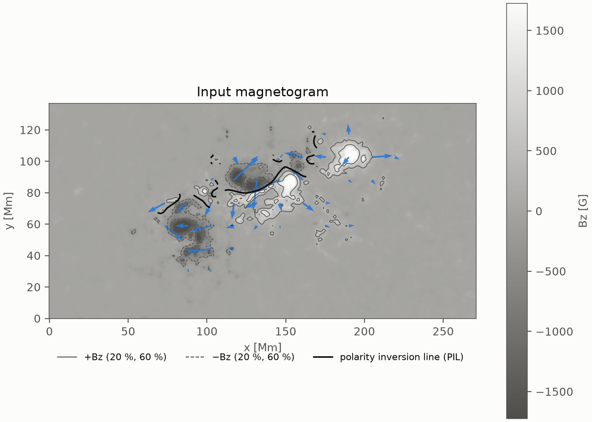
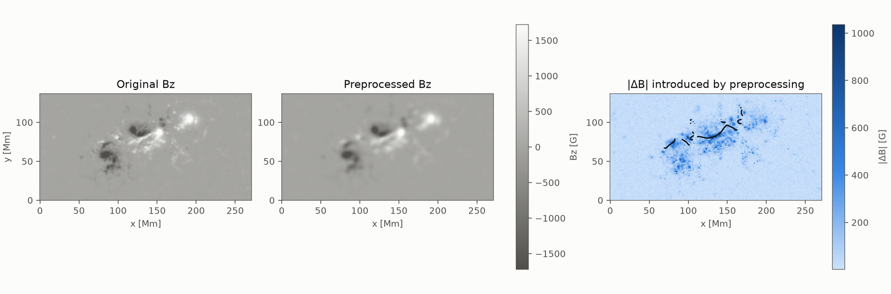
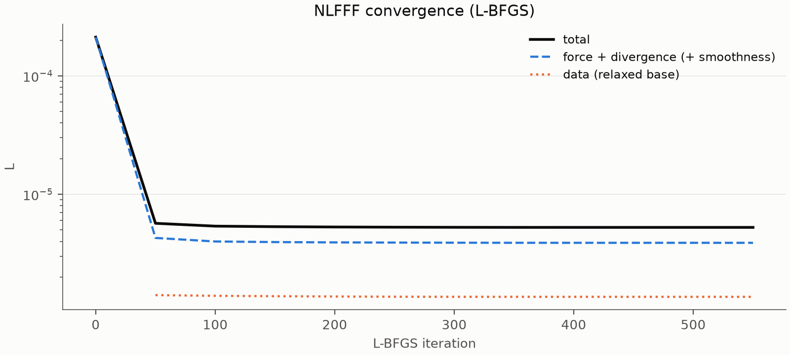
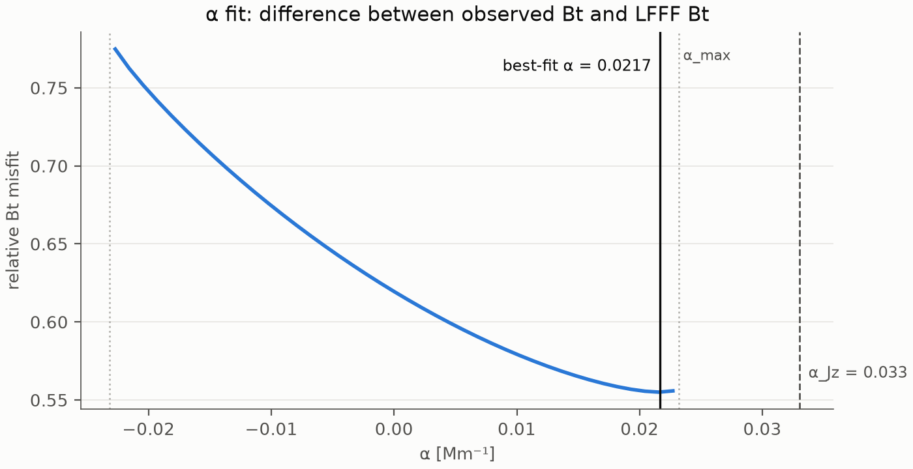
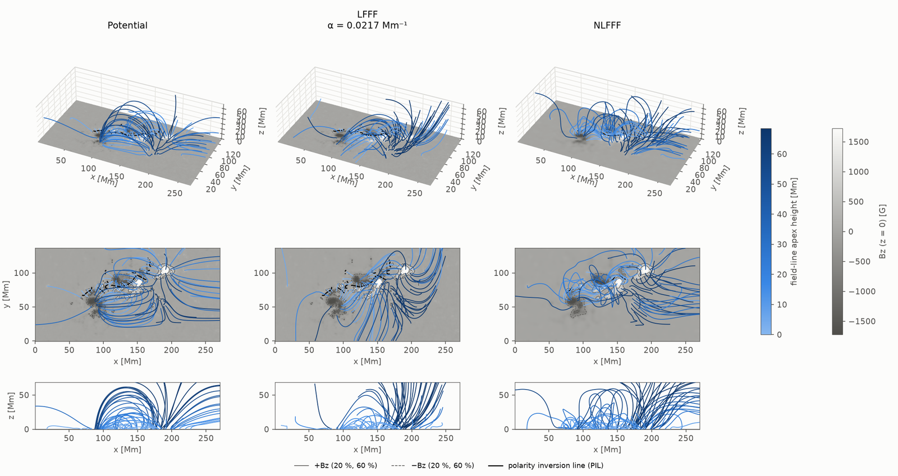
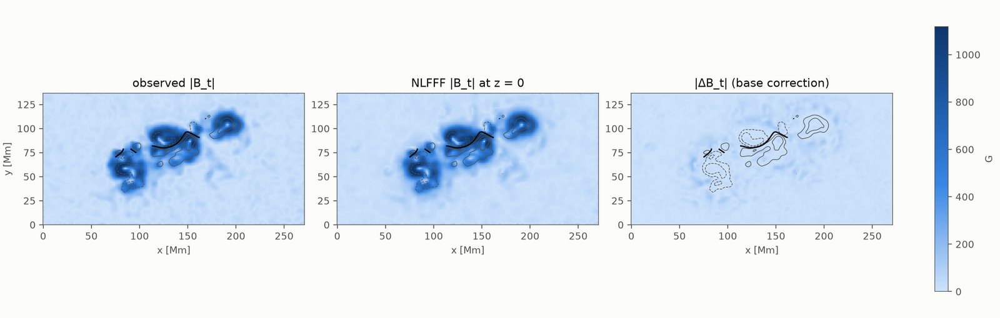
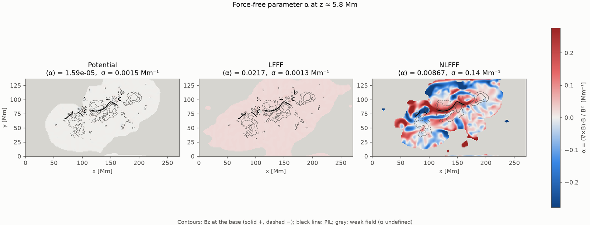

# An HMI active region, step by step

This page extrapolates NOAA 11158 on 2011-02-15 at 00:00 TAI (HARP 377), the region of every figure
in this documentation. Each step can be run on its own, so you can see and change what happens in
between. To run everything in one call, see [A full study](study-report.md).

## 1. Find and download the data

The input is the SHARP product in cylindrical equal-area projection, `hmi.sharp_cea_720s`: a vector
magnetogram on a local Cartesian grid, with the 180° ambiguity already resolved.

```python
import solarff as sff

sff.search_sharp("2011-02-15T00:00:00", noaa=11158)          # -> HARP number 377
folder = sff.download_sharp(377, "2011-02-15T00:00:00", email="you@example.org")
```

- `search_sharp` lists the HARP regions at that time. With `noaa` it keeps only that region.
- `download_sharp` saves the segments `Br`, `Bp`, `Bt` and their errors `*_err` in `out_dir`
  (`data` by default) and returns that folder ([parameters](parameters.md#download_sharp)).
- The email must be [registered at JSOC](http://jsoc.stanford.edu/ajax/register_email.html). It is
  only passed to JSOC and never stored.

## 2. Load, crop and reduce

```python
mag = sff.load_sharp_cea(folder, rebin=4)          # 4 x 4 pixels -> one cell of 1.46 Mm
mag = mag.balance_flux()                            # net flux zero
print(mag, mag.flux_imbalance())
sff.plot_magnetogram(mag)
```

*How the SHARP segments become the components of the library. **Segment**: the FITS file of the SHARP. **Meaning**: the component it holds. **In the library**: the Cartesian component it becomes, with x to the west and y to the north.*

| Segment | Meaning | In the library |
|---|---|---|
| `Br` | radial component | `Bz` |
| `Bp` | φ component (westward) | `Bx = Bp` |
| `Bt` | θ component (southward) | `By = -Bt` |

- **`rebin`** averages blocks of pixels. A full-resolution SHARP (0.36 Mm per pixel) is not tractable,
  so use 2 to 4. The number of cells falls with the square of the factor and the run time faster.
- **`crop`** keeps part of the map, by pixel index: `mag.crop(slice(100, 400), slice(50, 250))`.
  Leave a margin of weak field around the region, because the side faces are unobserved.
- **`balance_flux`** removes the net flux of `Bz`. Without it the potential field is not well posed.



*`plot_magnetogram`: the vertical field in grey, the contours at 20 % and 60 % of the maximum of each
polarity, the polarity inversion line in black and the transverse field as arrows.*

Practical advice:

- Use regions within 30–45° of the central meridian. Farther out the transverse noise grows quickly.
- The geometry is Cartesian, valid for regions up to about 200–300 Mm.

!!! tip "With sunpy maps"
    ```python
    import sunpy.map
    mag = sff.from_sunpy(sunpy.map.Map("Br.fits"), sunpy.map.Map("Bp.fits"), sunpy.map.Map("Bt.fits"), rebin=4)
    maps = sff.to_sunpy(mag)               # {"Br": Map, "Bp": Map, "Bt": Map}
    ```

## 3. Preprocess

The photosphere is not force-free, while the extrapolation assumes it is. The preprocessing of
Wiegelmann et al. (2006) changes the magnetogram as little as possible to remove its net force and
torque, and smooths it slightly ([equations](../method.md#step-1-preprocessing)).

```python
pp = sff.preprocess(mag)                            # defaults: mu3 = mu4 = 0.01
```



*Original and preprocessed $B_z$, and the change in the transverse field. The change concentrates in
the strong-field cores.*

*The parameters of `preprocess` you are most likely to change. **Parameter**, **Default**: its name and value if not given. **What it does**: its effect. **When to change it**: the situations that call for another value.*

| Parameter | Default | What it does | When to change it |
|---|---|---|---|
| `mu3` | 0.01 | how far the result may move from the data | 0.1 for photospheric data, see the note below |
| `mu4` | 0.01 | how much it is smoothed | rarely |
| `fix_bz` | `False` | modify only the transverse field | to keep the observed $B_z$ |

All the parameters are in the [reference](parameters.md#preprocess).

## 4. Extrapolate

```python
nz = 48
pot = sff.potential_field(mag, nz)                  # the reference, with zero current
alpha = sff.estimate_alpha(mag)                     # best single α for a linear field
lin = sff.lfff(mag, alpha, nz)
nl = sff.nlfff_lbfgs(pp, nz)                        # the nonlinear force-free model
print(nl.meta["iterations"], nl.meta["message"])
```

- **`nz`** is the number of levels in height, in cells. About half of the shorter side is a good
  start: the field above it is weak and the top face is unobserved.
- **`nlfff_lbfgs`** minimises the force, the divergence and the misfit to the data at the base
  ([equations](../method.md#step-2-extrapolation), [parameters](parameters.md#nlfff_lbfgs)). It uses
  every core of the machine. With PyTorch installed it is the recommended solver.
- **`estimate_alpha`** fits the transverse field with linear force-free fields of different α and keeps
  the best one.



*`nl.meta` and `study.nlfff_terms` keep the history of the functional: the total, the force and divergence term,
and the misfit to the data at the base. Most of the fall happens in the first iterations.*



*`estimate_alpha`: misfit of the transverse field against α. The best α is well inside the limit
$\alpha_{\max}$ above which the linear field cannot be computed in this box.*

!!! note "Photospheric magnetograms: a recommended alternative"
    Against a radiative MHD simulation of an active region, less smoothing and a base that is trusted
    less give fewer wrong lines, 48 % instead of 64 %:

    ```python
    pp = sff.preprocess(mag, mu3=1e-1, mu4=1e-2)
    nl = sff.nlfff_lbfgs(pp, nz, relax_bottom=1e-2)
    ```

    The per-line confidence is calibrated with the defaults. See
    [Tests against simulations](../realistic.md#recommended-treatment-of-a-photospheric-base).

## 5. Look at the result

```python
seeds = sff.seeds_from_magnetogram(mag, n=100)
sff.plot_comparison({"Potential": pot, "LFFF": lin, "NLFFF": nl}, seeds, save="lines.png")
sff.print_table(sff.compare_models({"Potential": pot, "LFFF": lin, "NLFFF": nl}))
```



*The same seeds in the three models, in 3D and seen from above and from the side, coloured by the
height of the apex. The NLFFF lines are lower and more sheared along the inversion line.*



*With `relax_bottom` the transverse field at the base may move away from the data. The right panel
shows by how much: little, and mostly where the field is strong.*



*`plot_alpha_maps`: α on a horizontal slice a few Mm above the base. The potential field has α = 0, the linear one a single
value, and the NLFFF concentrates the currents along the inversion line.*

## Next

- [Which of these lines can be trusted](lines-confidence.md).
- [Energy, helicity and eruptivity](energy-eruptivity.md) of the model.
