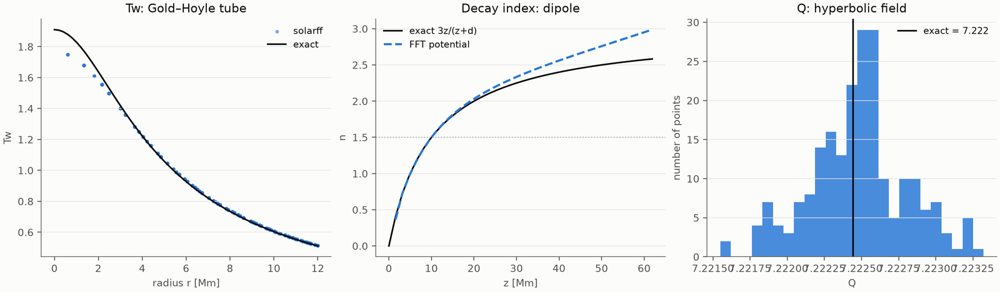

# Getting started

This section shows how to work with `solarff` in the most common cases. Each page is a complete
recipe: what goes in, the code, what comes out, and a figure of a real result. Every parameter is
explained in the [parameter reference](parameters.md).

## Choose your case

*Where to start. **I want to...**: the task. **Page**: the recipe that does it.*

| I want to... | Page |
|---|---|
| Check the installation against an exact solution | [First run](#first-run-an-exact-solution) (below) |
| Extrapolate an HMI active region, step by step | [An HMI active region](hmi-region.md) |
| Trace field lines and know which ones to trust | [Field lines and confidence](lines-confidence.md) |
| Run everything at once, with uncertainties and a PDF report | [A full study and its report](study-report.md) |
| Measure free energy, helicity, twist, decay index and QSLs | [Energy and eruptivity](energy-eruptivity.md) |
| Compare the model with the loops seen by SDO/AIA | [Comparison with AIA loops](aia-loops.md) |
| Test a method on analytical fields or MHD simulations | [Benchmarks and simulations](benchmarks.md) |
| Know what each parameter does | [Parameter reference](parameters.md) |

## Installation

`solarff` needs Python 3.10 or later.

```bash
git clone https://github.com/gabgarar/solarff.git
cd solarff
python -m venv .venv
source .venv/bin/activate          # Windows: .venv\Scripts\activate
pip install -e ".[all]"
```

*Optional groups of dependencies, installed with `pip install -e ".[name]"`. **Extra**: the name of the group. **Adds**: the packages it installs. **Needed for**: what stops working without it.*

| Extra | Adds | Needed for |
|---|---|---|
| `jsoc` | `drms` | downloading SHARP data from JSOC |
| `lbfgs` | `torch` | the recommended NLFFF solver (exact gradient, L-BFGS) |
| `aia` | `sunpy`, `drms` | sunpy interoperability and the comparison with AIA loops |
| `calibration` | `scikit-learn` | comparing classifiers when recalibrating |
| `dev` | `pytest` | running the tests |

`requirements-lock.txt` pins the exact versions used for the published results.

## First run: an exact solution

Before using real data, check the installation against the analytical field of Low & Lou (1990).
This takes about a minute.

```python
import solarff as sff

mag, exact = sff.low_lou_magnetogram(nx=32, ny=32, nz=24, noise=10.0)

pot = sff.potential_field(mag, nz=24)
nl = sff.nlfff_lbfgs(sff.preprocess(mag), nz=24)

seeds = sff.seeds_from_magnetogram(mag, n=200)
models = {"Exact": exact, "Potential": pot, "NLFFF": nl}
sff.print_table(sff.compare_models(models, reference="Exact", seeds=seeds))
sff.plot_comparison(models, seeds, save="lowlou_lines.png")
```

What each line does:

1. `low_lou_magnetogram` returns the magnetogram at the base, with 10 G of noise, and the exact 3D
   field to compare with ([parameters](parameters.md#analytical-fields)).
2. `potential_field` and `nlfff_lbfgs` extrapolate it to 24 levels in height
   ([parameters](parameters.md#extrapolation)). `preprocess` first makes the base closer to
   force-free ([parameters](parameters.md#preprocess)).
3. `seeds_from_magnetogram` chooses the points where the lines start, and `compare_models` traces
   them in every model and compares them with the exact ones ([metrics](../diagnostics.md#comparing-models)).

The NLFFF should be much closer to the exact field than the potential one: a vector correlation
`C_vec` near 1 and most lines with the same topology.



*The report of every region checks the diagnostics against fields with a known answer: the twist of
a Gold–Hoyle tube, the decay index of a dipole and the squashing factor of a hyperbolic field.*

## Units and conventions

- Distances in Mm, field in G, α in Mm⁻¹, energies in erg.
- 3D arrays are indexed `[ix, iy, iz]`, and `z = 0` is the magnetogram.
- Progress messages printed by the solvers, and the command-line help of the example scripts, are
  still in Spanish. The API, the docstrings and this documentation are in English.
