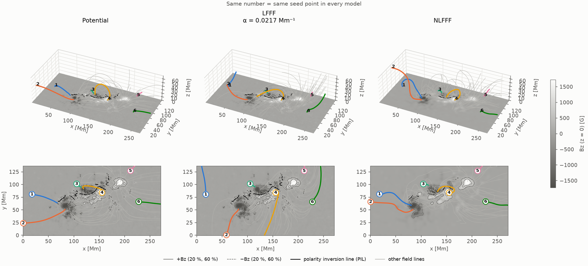
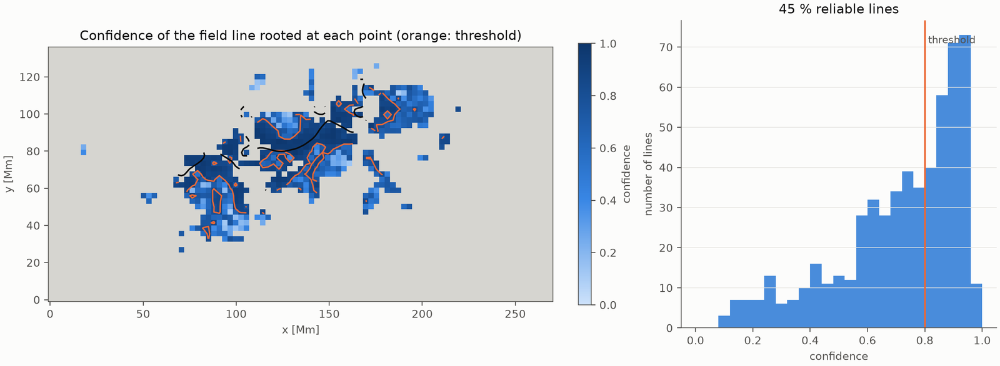
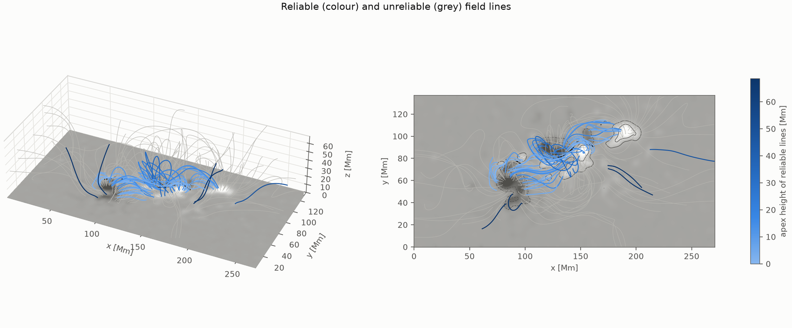
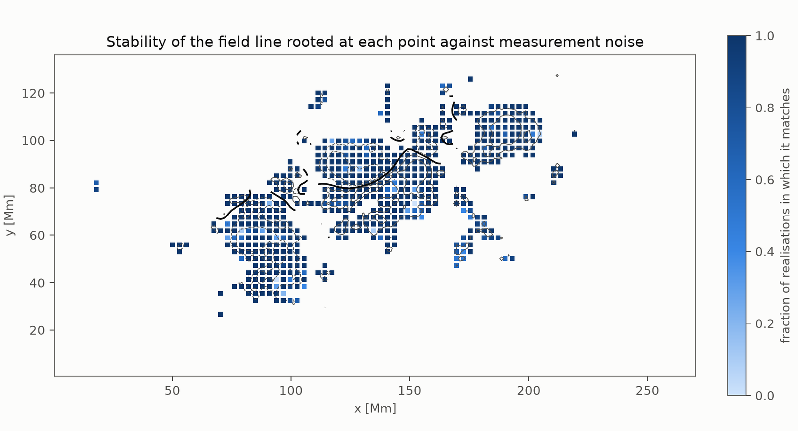

# Field lines and confidence

An extrapolation is a 3D field, but what is usually compared with observations, or used to describe
the connectivity of a region, are its field lines. This page traces them and gives each one a
confidence. It starts from the model `nl` and the magnetogram `mag` of the
[previous page](hmi-region.md).

## 1. Seeds: where the lines start

```python
seeds = sff.seeds_from_magnetogram(mag, n=300)                       # regular grid, positive polarity
seeds = sff.seeds_from_magnetogram(mag, n=300, polarity="both",
                                   method="random", rng=1)           # both polarities, more in the cores
```

| Parameter | Default | What it does |
|---|---|---|
| `n` | 80 | approximate number of seeds |
| `threshold` | 0.1 | seeds only where $\lvert B_z\rvert$ exceeds this fraction of its maximum |
| `polarity` | `"positive"` | `"positive"`, `"negative"` or `"both"`. A line is traced both ways, so one polarity avoids drawing a loop twice |
| `method` | `"grid"` | `"grid"` covers the region evenly; `"random"` draws more seeds where the field is strong |
| `z` | one cell | height of the seeds. Above the base, where the NLFFF is noisier |
| `rng` | 0 | random seed, for `method="random"` |

The seeds are an array `(N, 3)` in Mm. Use the **same seeds** in every model you want to compare.

## 2. Trace

```python
lines = sff.trace_field_lines(nl, seeds)
l = lines[0]
l.points, l.length, l.apex, l.closed          # (M, 3) in Mm, length in Mm, maximum height, both ends on the base
```

`ds` is the integration step in cells (0.5 by default) and `max_steps` the longest line
([parameters](parameters.md#trace_field_lines)).



*The same numbered seeds in the potential, linear and NLFFF models. Where a seed lands on a different
footpoint, the models disagree about the connectivity of the region.*

## 3. Confidence of each line

```python
a = sff.assess_lines(nl, lines, mag=mag)
a["confidence"]      # one value in [0, 1] per line
a["reliable"]        # confidence >= a["threshold"], 0.8 by default
a["indicators"]      # the quantities the confidence is computed from
```

The confidence is one minus the probability that the line is wrong, estimated from three properties
of the line: how much α varies along it, how much of it lies in the boundary layer, and its length
([how it was calibrated](../confidence.md#how-it-was-calibrated)). Pass `mag`, the magnetogram used as
the boundary condition, so the indicators that need it can be computed.



*`confidence_map`: the confidence of the line that leaves each pixel of the base, and its histogram.
The orange line is the threshold.*



*Reliable lines in colour and unreliable ones in grey. The long lines that reach the unobserved faces
of the box are the least reliable.*

!!! warning "Read the limits first"
    The confidence is calibrated on exact force-free fields. Against a simulated active region it
    does not hold: 51 % of the accepted lines are wrong there. For a real region use it to rank lines,
    not as an error probability. See [Tests against simulations](../realistic.md).

## 4. Maps and volumes

```python
cm = sff.confidence_map(nl, mag=mag, step=2)          # one line per 2 x 2 pixels
cm["conf"], cm["reliable"], cm["x"], cm["y"]           # 2D maps on the base

vol = sff.reliable_volume(nl, lines, a["reliable"], dilate=1)   # 3D mask threaded by reliable lines
```

- `step` sets the spacing of the seeds in pixels, and `threshold` the weakest field seeded.
- `reliable_volume` marks the cells crossed by reliable lines, widened by `dilate` cells. Use it to
  restrict an energy or a current to the trusted part of the volume, and state that you did.

## 5. Stability against the measurement noise

```python
mc = sff.monte_carlo(study, n=10)          # study = sff.run_study(mag, nz=48)
mc["stability"]                            # per line: fraction of realisations in which it is the same line
```



*Each point is a seed of the base, coloured by the fraction of the ten Monte Carlo realisations in
which the line stays the same. Unstable lines cluster in the weak-field parts.*

The Monte Carlo is described in [A full study](study-report.md#2-uncertainties-monte-carlo).

## 6. An ordering for MHD-like data (experimental)

```python
r = sff.rank_lines(nl, lines, mag=mag)
r["order"]           # indices of the lines, from the most to the least reliable
r["percentile"]      # 0 for the most reliable line of this model, 1 for the least
```

`rank_lines` uses six indicators fitted on radiative MHD simulations, among them the departure of
each line from the potential line of the same seed (`potential_departure`). It returns an order and
no probability, and it is not confirmed on real data.

## Interactive 3D view

```bash
python tools/lines3d.py my_study.pkl -o my_region.html
```

A single HTML page with every line of the region in 3D, coloured by height or by confidence. See
[Diagnostics](../diagnostics.md#interactive-3d-view).
