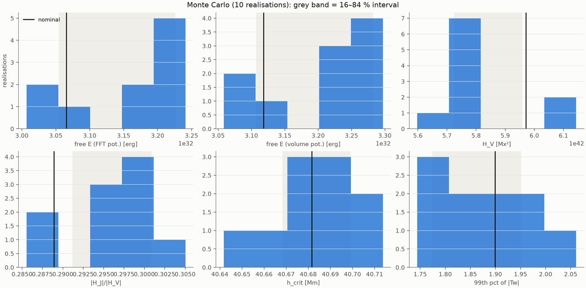
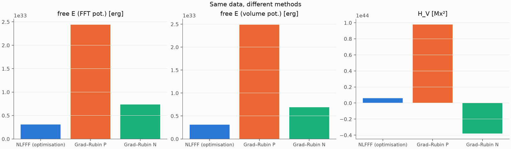
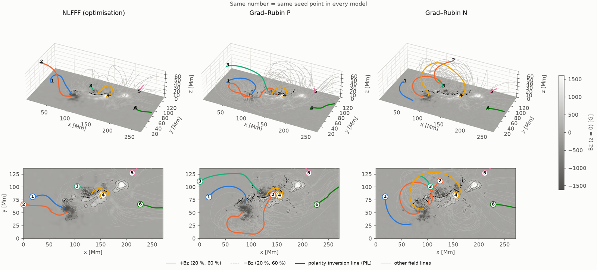

# A full study and its report

`run_study` runs the whole chain of [the previous pages](hmi-region.md) in one call, and
`generate_report` turns it into a PDF report in English and Spanish that explains every number.

## 1. One call

```python
import solarff as sff

mag = sff.load_sharp_cea("data/harp377", rebin=4).balance_flux()
study = sff.run_study(mag, nz=48, n_seeds=100, name="NOAA 11158")
study.potential, study.lfff, study.nlfff         # the three models
study.mag_pp                                     # the preprocessed magnetogram
study.nlfff_converged, study.nlfff_message
```

| Parameter | Default | What it does |
|---|---|---|
| `nz` | required | levels in height |
| `preprocess` | `True` | preprocess before the NLFFF |
| `preprocess_kw` | `None` | arguments for [`preprocess`](parameters.md#preprocess), e.g. `{"mu3": 0.1}` |
| `alpha`, `alpha_method` | `None`, `"fit"` | α of the linear field, or how to estimate it |
| `nlfff_method` | `"auto"` | `"lbfgs"` (recommended), `"classic"` (fixed base, no PyTorch) or `"auto"` |
| `nlfff_kw` | `None` | arguments for [`nlfff_lbfgs`](parameters.md#nlfff_lbfgs), e.g. `{"max_iter": 4000}` |
| `n_seeds` | 80 | seeds for the figures and the comparisons |
| `exact` | `None` | exact field, for benchmarks |

The recommended treatment of a photospheric base is
`run_study(mag, 48, preprocess_kw={"mu3": 0.1}, nlfff_kw={"relax_bottom": 0.01})`
([why](../realistic.md#recommended-treatment-of-a-photospheric-base)).

Save the study, because an NLFFF of a real region takes minutes:

```python
import pickle
pickle.dump(study, open("my_region.pkl", "wb"))
```

## 2. Uncertainties: Monte Carlo

```python
mc = sff.monte_carlo(study, n=10, checkpoint="my_region_mc.pkl")
mc["summary"]["E_free"]          # mean, std, p16, p50, p84 and the nominal value
```

The preprocessing and the NLFFF are repeated `n` times, each with noise drawn from the HMI error
maps (`*_err` segments). Each realisation costs as much as the nominal extrapolation.

| Parameter | Default | What it does |
|---|---|---|
| `n` | 10 | number of realisations |
| `error_scale` | 1 | factor on the HMI errors, above 1 if you think they are underestimated |
| `noise` | `None` | a uniform σ in G instead of the error maps |
| `checkpoint` | `None` | file where the progress is saved; an interrupted run resumes from it |



*Distribution of six quantities over ten realisations, with the nominal value as a vertical line and
the 16–84 % band in grey.*

!!! warning "These are lower bounds"
    The Monte Carlo includes neither systematic errors, nor errors of the ambiguity resolution, nor
    the dependence on the method of extrapolation.

## 3. Another method: Grad–Rubin

```python
sff.add_grad_rubin(study)            # solutions from the positive and the negative polarity
study.grad_rubin["P"], study.grad_rubin["N"]
```

Grad–Rubin builds the field from α on one polarity only. With real data the two polarities give
different answers, and the distance between them, and to the NLFFF, is an estimate of the error of
the method ([parameters](parameters.md#nlfff_grad_rubin)).



*Free energy, free energy against the volume potential, and current-carrying helicity of the three
methods on the same data. In this region they differ by factors of two to five.*



*The same seeds in the three models.*

## 4. The report

```python
sff.generate_report(study, "reports/noaa11158", monte_carlo=mc, title="NOAA 11158")
# -> reports/noaa11158/informe_es.pdf, report_en.pdf, figures/, paper/
```

| Parameter | Default | What it does |
|---|---|---|
| `langs` | `("es", "en")` | languages of the report |
| `monte_carlo` | `None` | result of `monte_carlo`, adds error bars and the stability of each line |
| `aia` | `None` | result of the [AIA comparison](aia-loops.md) |
| `validation` | `True` | add the analytical tests of the diagnostics |
| `compile` | `True` | run pdflatex. Without LaTeX the `.tex` files are left ready |

The report has about 45 pages: a summary, the data, each step with its figure and a box on how to
read it, the reliability of the lines, energy and helicity, eruptivity, uncertainties, the
limitations and the references. The folder `paper/` holds the tables in LaTeX, a methods paragraph,
the BibTeX and a JSON with every number.

The figures of this documentation come from the report of NOAA 11158.

## From the command line

```bash
python examples/02_hmi_sharp.py --email you@example.org --harp 377 --time 2011-02-15T00:00:00 --mc 10
```

The script downloads the data if needed, runs the study, the Monte Carlo and Grad–Rubin, caches the
result in `data/` and writes the report. `--help` lists the options.
