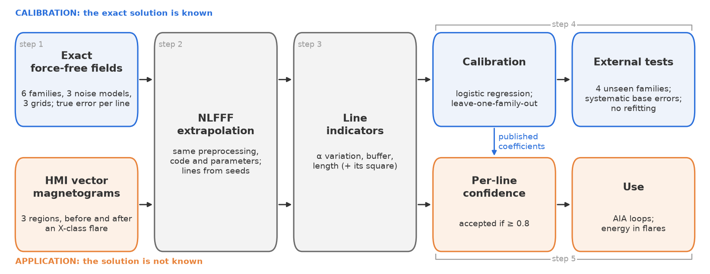
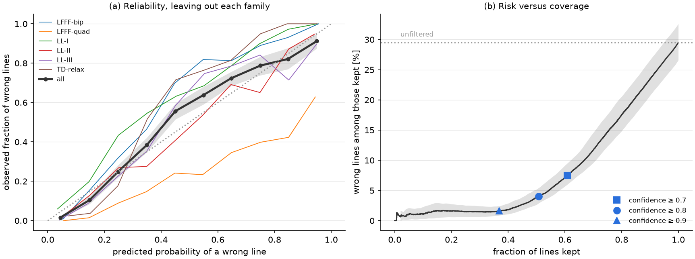
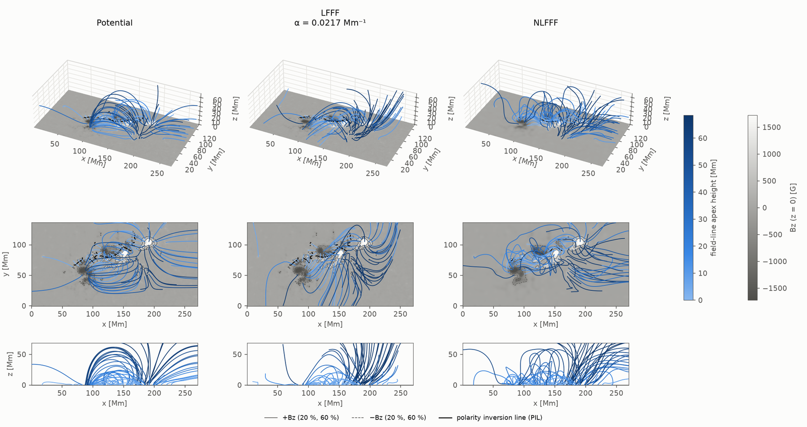
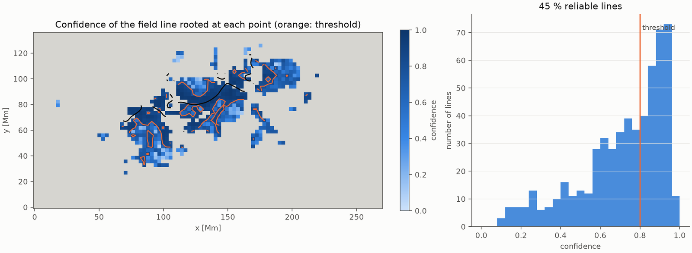
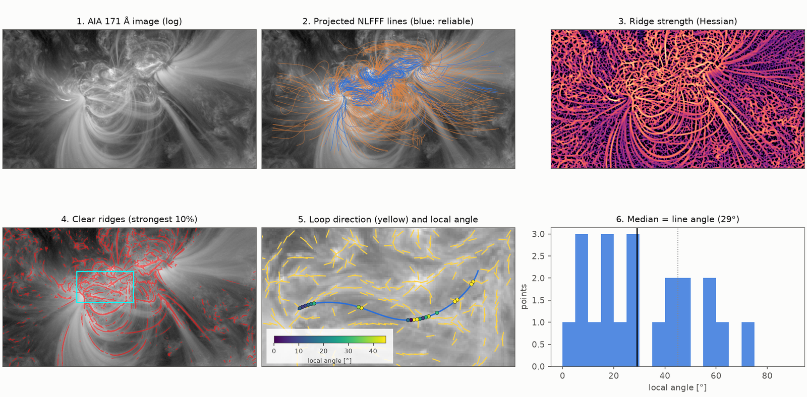
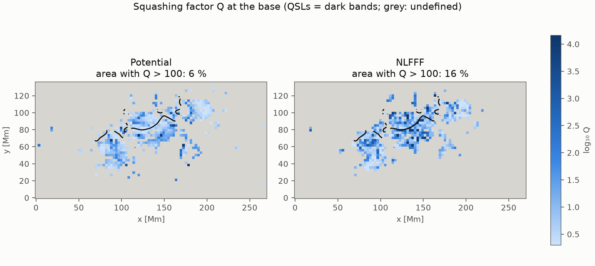
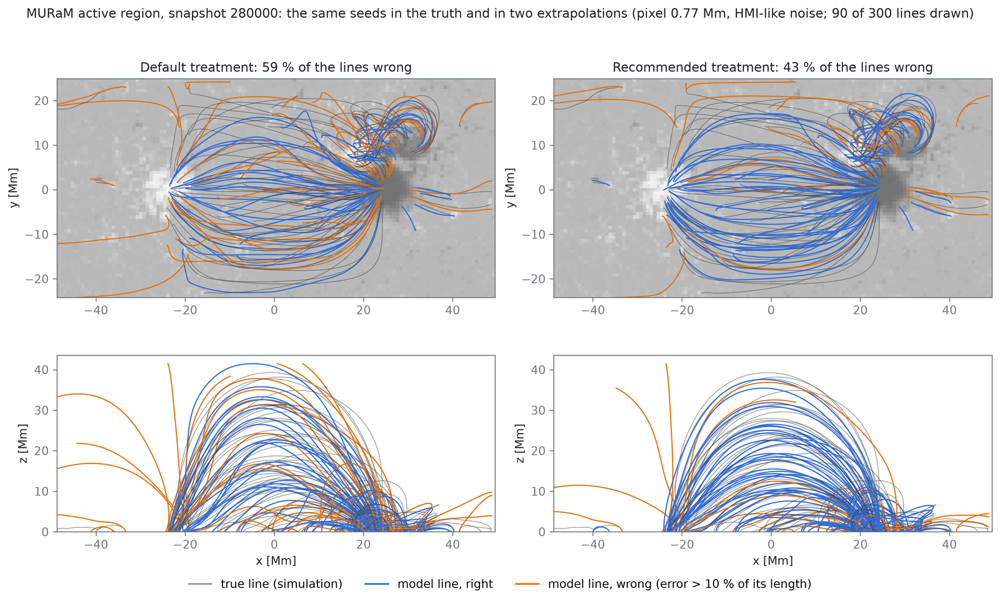

# solarff

**Nonlinear force-free field (NLFFF) extrapolation of the solar coronal magnetic field in Python,
from SDO/HMI vector magnetograms, with a confidence for every field line.**

A nonlinear force-free (NLFFF) extrapolation gives a full 3D field, but not all of it deserves the
same trust. `solarff` computes the extrapolation and then tells you, line by line, how likely each
field line is to reproduce the true geometry.

## What it does

| Task | Functions |
|---|---|
| Potential, linear and nonlinear force-free extrapolation | `potential_field`, `lfff`, `nlfff_lbfgs`, `nlfff` |
| Preprocessing of the vector magnetogram | `preprocess` |
| Field-line tracing | `trace_field_lines`, `seeds_from_magnetogram` |
| **Per-line confidence** | `assess_lines`, `confidence_map`, `reliable_volume` |
| Ranking of the lines fitted on MHD simulations (experimental) | `potential_departure`, `rank_lines` |
| Free energy and relative helicity with their uncertainties | `helicity_report`, `monte_carlo` |
| Twist, decay index and squashing factor Q | `twist_map`, `decay_index_profile`, `squashing_q` |
| Download and reading of SHARP data, sunpy interoperability | `download_sharp`, `load_sharp_cea`, `from_sunpy`, `to_sunpy` |
| Public MHD simulation cubes as a truth | `solarff.simulations.reduced_field` |
| PDF report of a region | `run_study`, `generate_report` |

## The idea in one figure

The confidence is a logistic regression on three indicators of each line: the variation of the
force-free parameter α along it, the fraction of the line inside the boundary layer of the
extrapolation, and its length. It is calibrated on exact force-free fields, where the true error of
every line is known, and validated by leaving out one whole family of fields at a time.

With the default threshold (confidence ≥ 0.8) about half of the lines are accepted, and about 4 % of
the accepted ones are wrong, against about 30 % of all lines.

!!! warning "Against a simulated active region the confidence does not hold"
    With a radiative MHD simulation as the truth, whose photosphere is not force-free, 62 % of the
    lines are wrong and so are 51 % of the accepted ones. A treatment of the base that trusts it
    less lowers the wrong lines from 64 to 48 %. Read [Tests against simulations](realistic.md)
    before applying the confidence to a real region.

## What it produces

Every figure below comes from the report of NOAA 11158 that the library writes on its own.

*Tested against a radiative MHD simulation: the same seeds in the simulation (grey) and in two
extrapolations, blue where the line is right and orange where it is wrong. See
[Tests against simulations](realistic.md).*

*Field lines of the potential, linear and NLFFF models; confidence of the line that leaves each
pixel; measurement of the angle with the loops seen by AIA; quasi-separatrix layers at the base.*

## Where to go next

- [Getting started](getting-started/index.md): installation and recipes for each use case, from a
  first extrapolation to a full report, with every parameter explained.
- [Method and equations](method.md): the physical context, every equation, and the inputs and outputs of each step.
- [Per-line confidence](confidence.md): how to apply it to your own extrapolation, and its limits.
- [Tests against simulations](realistic.md): the confidence against MHD simulations, and the
  recommended treatment of a photospheric base.
- [Diagnostics](diagnostics.md): energy, helicity, twist, decay index, QSLs and Monte Carlo errors.
- [Reproducing the results](reproduce.md): every figure and number, from the scripts.
- [API reference](api/core.md): generated from the source code.

`solarff` is free software under the BSD 3-Clause license. If you use it, please [cite it](cite.md).
