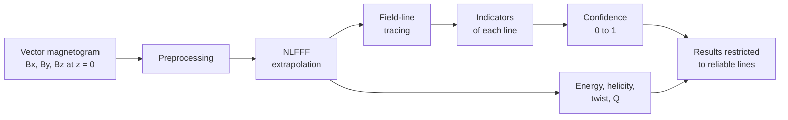

# Method and equations

This page puts the library in context: the physical problem, the equations each step solves, and
what goes in and comes out of every function.

## The problem

The magnetic field of the solar corona stores the energy released in flares and eruptions, but it
cannot be measured directly. What is measured routinely is the vector field at the photosphere.
The coronal field is then *extrapolated* from that boundary, assuming that in the low corona the
magnetic force dominates and the field is close to force-free:

$$
(\nabla\times\mathbf{B})\times\mathbf{B} = 0, \qquad \nabla\cdot\mathbf{B} = 0 .
$$

The first equation says the electric current is parallel to the field, so it can be written with a
scalar, the force-free parameter $\alpha$:

$$
\nabla\times\mathbf{B} = \alpha\,\mathbf{B}, \qquad
\alpha = \frac{(\nabla\times\mathbf{B})\cdot\mathbf{B}}{B^2}, \qquad
\mathbf{B}\cdot\nabla\alpha = 0 .
$$

The last relation follows from taking the divergence: in an exact solution $\alpha$ is constant along
each field line. Three models of increasing realism follow from what is assumed about $\alpha$.

| Model | Assumption | Boundary data needed |
|---|---|---|
| Potential | $\alpha = 0$ (no currents) | $B_z$ |
| Linear force-free (LFFF) | $\alpha$ constant everywhere | $B_z$ and one value of $\alpha$ |
| Nonlinear force-free (NLFFF) | $\alpha$ varies from line to line | $B_x$, $B_y$, $B_z$ |

The NLFFF is the realistic one, but it is an ill-posed numerical problem: the photosphere is not
force-free, the side and top boundaries are unknown, and the data are noisy. The result is a field
that is good in some places and wrong in others. The per-line confidence is the tool to tell them
apart.

## The pipeline

Each step is one function call:

| Step | Function | Input | Output |
|---|---|---|---|
| Read data | `load_sharp_cea`, `from_sunpy` | SHARP CEA segments | `Magnetogram` |
| Preprocess | `preprocess` | `Magnetogram` | `Magnetogram` |
| Extrapolate | `nlfff_lbfgs` | `Magnetogram`, `nz` | `VectorField3D` |
| Trace | `trace_field_lines` | `VectorField3D`, seeds | list of `FieldLine` |
| Assess | `assess_lines` | field, lines, magnetogram | confidence and mask per line |
| Diagnose | `helicity_report`, `twist_map`, `squashing_q` | `VectorField3D` | dictionaries |

## Data structures

**`Magnetogram`**, the photospheric boundary on a local Cartesian grid.

| Attribute | Meaning | Units |
|---|---|---|
| `bx`, `by`, `bz` | field components, arrays of shape (nx, ny); `bz` is vertical | G |
| `bx_err`, `by_err`, `bz_err` | 1σ uncertainty per pixel, if known | G |
| `dx` | pixel size | Mm |
| `origin` | coordinates of pixel [0, 0] | Mm |
| `meta` | header information | — |

**`VectorField3D`**, a field in the volume.

| Attribute | Meaning | Units |
|---|---|---|
| `bx`, `by`, `bz` | field components, arrays of shape (nx, ny, nz) | G |
| `dx` | grid step, the same in the three directions | Mm |
| `origin` | coordinates of node [0, 0, 0] | Mm |
| `meta` | method, parameters, convergence history, buffer width `nd` | — |

## Step 1: preprocessing

The photospheric field is not force-free, so it is not a consistent boundary for a force-free
solution. A consistent boundary must have zero net force and zero net torque (Aly 1989). The library
measures the departure with

$$
\epsilon_F = \frac{\left|\sum B_xB_z\right| + \left|\sum B_yB_z\right| + \left|\sum (B_z^2 - B_x^2 - B_y^2)\right|}{\sum (B_x^2+B_y^2+B_z^2)} ,
$$

and an analogous $\epsilon_T$ for the torque (`aly_criteria`). Following Wiegelmann, Inhester &
Sakurai (2006), the magnetogram is modified slightly by minimising

$$
L_{\rm pre} = \mu_1 L_1 + \mu_2 L_2 + \mu_3 L_3 + \mu_4 L_4 ,
$$

where $L_1$ is the net force, $L_2$ the net torque, $L_3 = \sum|\mathbf{B}-\mathbf{B}_{\rm obs}|^2$
the distance to the data and $L_4 = \sum|\Delta\mathbf{B}|^2$ the smoothness. Each term is normalised
by its mean, so the weights do not depend on the size or strength of the magnetogram.

| Parameter | Default | Meaning |
|---|---|---|
| `mu1`, `mu2` | 1 | weight of the force and torque terms |
| `mu3` | 10⁻² | how far the result may move from the data |
| `mu4` | 10⁻² | how much it is smoothed |
| `fix_bz` | `False` | modify only the transverse components |

!!! warning
    The confidence is calibrated with these defaults. Changing `mu3` or `mu4` degrades it without
    notice.

## Step 2: extrapolation

**Potential and linear fields** are solved in Fourier space (Alissandrakis 1981). Each horizontal
mode $\mathbf{k}$ of $B_z$ at the base decays with height as $e^{-\sqrt{k^2-\alpha^2}\,z}$, which
requires $|\alpha| < 2\pi/L$ for a box of side $L$. `potential_field(mag, nz)` is the case
$\alpha = 0$, and `lfff(mag, alpha, nz)` the general one.

**The NLFFF** minimises a functional over the volume (Wheatland et al. 2000; Wiegelmann 2004):

$$
\begin{aligned}
L ={}& \left\langle w\left[\frac{|(\nabla\times\mathbf{B})\times\mathbf{B}|^2}{B^2+\varepsilon^2}
 + w_d\,|\nabla\cdot\mathbf{B}|^2\right]\right\rangle_V \\
 &+ \nu\left\langle W\,|\mathbf{B}_t-\mathbf{B}_{t,\rm obs}|^2\right\rangle_{z=0}
 + \lambda\left\langle|\nabla^2\mathbf{B}|^2\right\rangle_V .
\end{aligned}
$$

The first term is the force and the divergence, the second lets the transverse field at the base
adjust within the noise (Wiegelmann & Inhester 2010), and the third penalises grid-scale
oscillations. The weighting function $w$ is 1 in the interior and falls to 0 in a *buffer layer* of
`nd` cells next to the side and top boundaries, which are fixed to the potential field. The gradient
is exact, by automatic differentiation, and the minimiser is L-BFGS.

| Parameter of `nlfff_lbfgs` | Default | Symbol and meaning |
|---|---|---|
| `nz` | required | number of grid levels in height |
| `nd` | max(4, min(nx, ny, nz)/10) | width of the buffer layer, in cells |
| `relax_bottom` | 0.1 | $\nu$, freedom of the transverse field at the base |
| `eps` | 0.03 | $\varepsilon$ in units of max abs($B_z$), regularisation near nulls |
| `smooth` | 10⁻² | $\lambda$, smoothness |
| `div_weight` | 1 | $w_d$, weight of the divergence term |
| `max_iter`, `tol` | 2000, 10⁻⁶ | stopping criteria |

The output is a `VectorField3D`. Its quality is summarised by the current-weighted angle between
$\mathbf{J}$ and $\mathbf{B}$,

$$
\mathrm{CW}_{\sin} = \frac{\sum_i |\mathbf{J}_i|\,\sigma_i}{\sum_i |\mathbf{J}_i|}, \qquad
\sigma_i = \frac{|\mathbf{J}_i\times\mathbf{B}_i|}{|\mathbf{J}_i|\,|\mathbf{B}_i|},
$$

which is 0 for an exactly force-free field, and by the fractional flux $\langle|f_i|\rangle$, which
measures the residual divergence.

## Step 3: field lines

A field line is the solution of $d\mathbf{r}/ds = \mathbf{B}/|\mathbf{B}|$. It is integrated in both
directions from a seed with fourth-order Runge–Kutta on the trilinearly interpolated field.

| Parameter of `trace_field_lines` | Default | Meaning |
|---|---|---|
| `seeds` | required | array (N, 3) of starting points, in Mm |
| `ds` | 0.5 | integration step, in cells |
| `max_steps` | 4000 | maximum steps per direction |

`seeds_from_magnetogram(mag, n, threshold, polarity)` places `n` seeds where abs($B_z$) exceeds
`threshold` times its maximum. Each `FieldLine` holds its points in Mm, its seed and whether both ends
are at the base (`closed`).

## Step 4: indicators and confidence

Three quantities are computed on each extrapolated line, with no knowledge of the true field.

| Indicator | Definition | Why it reveals a wrong line |
|---|---|---|
| Variation of α | $x_1 = \log_{10}$ of the spread of $\alpha$ along the line, relative to its mean | $\alpha$ must be constant along a line of an exact solution |
| Buffer fraction | $x_2$ = fraction of the line inside the buffer layer | there the field is set by unobserved boundaries |
| Length | $x_3 = \log_{10}(L/D)$, with $D$ the horizontal diagonal of the box, and $x_4 = (x_3 + 0.54)^2$ | long lines accumulate error; very short ones fail in flux ropes |

They are combined in a logistic regression. The probability that a line is wrong is

$$
p = \frac{1}{1+\exp\left[-\left(\beta_0+\sum_i \beta_i z_i\right)\right]}, \qquad
z_i = \frac{x_i-\mu_i}{\sigma_i},
$$

and the confidence is $1 - p$. The published coefficients, with $\beta_0 = -1.33$, are:

| Term $x_i$ | $\mu_i$ | $\sigma_i$ | $\beta_i$ |
|---|---|---|---|
| $\log_{10}$ (variation of α) | −0.788 | 0.606 | +0.79 |
| buffer fraction | 0.166 | 0.277 | +0.79 |
| $\log_{10}(L/D)$ | −0.543 | 0.313 | +1.12 |
| $(\log_{10}(L/D)+0.54)^2$ | 0.098 | 0.162 | +0.78 |

The whole model fits in this table, so it can be applied without the library.

**Output of `assess_lines(field, lines, mag)`:**

| Key | Content |
|---|---|
| `confidence` | array with one value in [0, 1] per line |
| `reliable` | boolean array, confidence ≥ threshold |
| `threshold` | the acceptance threshold, 0.8 by default |
| `indicators` | dictionary with every indicator of every line |

### How the coefficients were obtained

A line is labelled *wrong* by comparing it with the exact line traced from the same seed. Both are
parametrised by normalised arc length $s$ and the shape error is

$$
\epsilon = \frac{1}{L_{\rm ref}}\int_0^1 \left|\mathbf{r}_{\rm NLFFF}(s)-\mathbf{r}_{\rm ref}(s)\right|ds .
$$

A line is wrong if $\epsilon > 0.1$ or if it changes between open and closed. The model is then
judged by:

| Measure | Definition | Question it answers |
|---|---|---|
| AUC | probability that a wrong line gets a higher $p$ than a good one | does it rank the lines? |
| ECE | $\sum_m \frac{\lvert B_m\rvert}{n}\,\lvert\bar y(B_m)-\bar p(B_m)\rvert$ over 10 bins of $p$ | can the probability be read literally? |
| Brier score | $\frac{1}{n}\sum_i (p_i-y_i)^2$ | both at once |
| Risk–coverage | fraction of wrong lines among those kept, against the fraction kept | which threshold suits my use? |

## Step 5: energy, helicity and topology

With $\mathbf{B}_p$ the potential field that has the same normal component on the six faces of the
box, the energy is decomposed following Valori et al. (2013). Two free energies are given:

$$
E_{\rm free} = E - E_p, \qquad
E_J = \frac{1}{8\pi}\int_V |\mathbf{B}-\mathbf{B}_p|^2\,dV ,
$$

which coincide only if the field is solenoidal. The fraction $E_{\rm div}/E$ measures how much of
the energy is spurious because of the residual divergence.

The relative magnetic helicity (Finn & Antonsen 1985) is

$$
H_V = \int_V (\mathbf{A}+\mathbf{A}_p)\cdot(\mathbf{B}-\mathbf{B}_p)\,dV ,
$$

with the vector potentials in the DeVore gauge. It is computed with two reference faces, and the
difference between them is the numerical error of the helicity.

**Output of `helicity_report(field)`:**

| Key | Content | Units |
|---|---|---|
| `energy` | `E`, `E_p`, `E_free`, `E_J`, `E_div`, `E_div_frac` and the other terms of the decomposition | erg |
| `helicity` | `H_V`, `H_J`, `H_PJ` and `ratio_HJ_HV`, gauge referred to the top face | Mx² |
| `helicity_bottom_gauge` | the same, gauge referred to the bottom face | Mx² |
| `gauge_diff` | relative difference between the two gauges | — |
| `potential` | the reference potential field $\mathbf{B}_p$ | G |

Three more diagnostics describe whether a region can erupt:

| Quantity | Definition | Function |
|---|---|---|
| Twist number | $T_w = \dfrac{1}{4\pi}\displaystyle\int \alpha\,dl$ along each line | `twist_map`, `twist_number` |
| Decay index | $n(z) = -\dfrac{d\ln B_h}{d\ln z}$ of the potential field above the inversion line | `decay_index_profile` |
| Squashing factor | $Q$, how strongly the line mapping between footpoints distorts a small circle | `squashing_q` |

A flux rope is usually taken as abs($T_w$) ≳ 1, torus instability as $n \geq 1.5$, and a
quasi-separatrix layer as $Q \gg 2$.

## Units and conventions

- Field in gauss, lengths in megametres, energy in erg, helicity in Mx².
- Axes: $x$ westward, $y$ northward, $z$ vertical. From SHARP: $B_x = B_p$, $B_y = -B_t$, $B_z = B_r$.
- The geometry is Cartesian, with no curvature, valid for regions up to about 200–300 Mm.

## References

Every citation on this page links to its entry in the [references](references.md).
