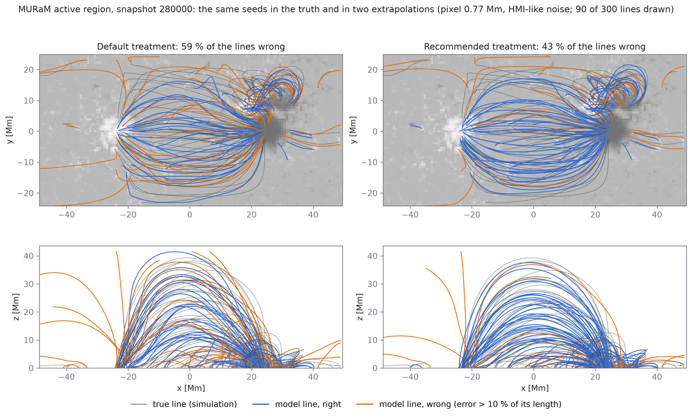
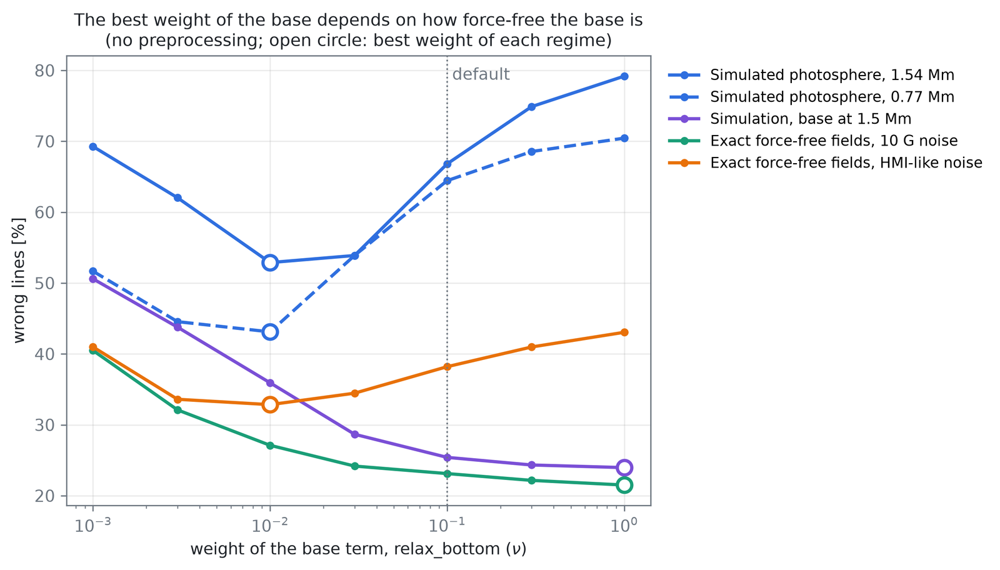

# Tests against simulations

The per-line confidence of this library is calibrated on exact force-free fields. This page reports
what happens when the truth is a radiative MHD simulation, whose photosphere is not force-free.

!!! warning "Main result"
    Against a simulated active region, 62 % of the lines of the default extrapolation are wrong and
    the published confidence does not separate them: 51 % of the accepted lines are wrong. For real
    magnetograms, do not read the confidence as an error probability.

The treatment of the base changes the result more than anything else tested here. A configuration
that trusts the base less is recommended below for photospheric magnetograms.

## How the tests were made

| Simulation | Code | What it is | Reference |
|---|---|---|---|
| `ar098192` | MURaM | active region with a flare | Cheung et al. (2019) |
| `qs024048_by3363` | Bifrost | flux emergence | Hansteen et al. (2017) |
| `en024048_hion` | Bifrost | enhanced network | Carlsson et al. (2016) |

- The three are public cubes of the [Oslo catalogue](https://sdc.uio.no/search/simulations).
  `solarff.simulations.reduced_field` downloads a snapshot and reduces it to the grid of the
  extrapolation.
- The magnetogram is the field of the simulation at the base, with the three noise models of the
  calibration. The active region is used with pixels of 1.54 and 0.77 Mm.
- The lines of the model and of the simulation are traced from the same seeds. A line is wrong by
  the definition of the calibration: mean distance above 10 % of the length, or a change between
  open and closed. Some results are also given with 20 %.
- The criteria of every test were written down before running it, and the final tests use
  snapshots that had not been opened before.

## What a wrong line looks like



*One case of the final test, on a snapshot never used before: pixel 0.77 Mm and HMI-like noise. The
true lines of the simulation are grey; each model line traced from the same seed is blue if it
follows the true one and orange if it is wrong. Top, seen from above; bottom, from the side. With the
default treatment of the base 59 % of the 300 lines are wrong, with the recommended one 43 %. The
default model makes many loops too high and opens lines that are closed in the simulation. 90 lines
are drawn; the percentages count all 300.*

`examples/46_simulation_figures.py` draws the two figures of this page. A version at 300 dpi is
written to `docs/informes/simulations/`.

## The calibrated confidence does not hold

Eighteen extrapolations of the simulated active region (three snapshots, two pixels, three noise
models, 5397 lines), with the default settings and the published coefficients, nothing refitted:

| | Calibration suite | Simulated active region |
|---|---|---|
| Wrong lines | 29 % | 62 % |
| Lines accepted (confidence ≥ 0.8) | 51 % | 36 % |
| Wrong among the accepted | 4.4 % | 51 % (45 to 56) |

- The confidence barely ranks the lines there: AUC 0.61.
- `CWsin` of these models is 0.22 to 0.26, just above the range of the calibration, so the range
  check of the [confidence page](confidence.md#applying-it-to-your-own-extrapolation) does flag
  them. Passing that check remains necessary, not sufficient.
- The simulation loses 8 % of its free energy across the flare. The models do not reproduce the
  drop: their free energy changes by 0 to +8 % with the 0.77 Mm pixel and by +14 to +22 % with the
  1.54 Mm pixel.
- In the two Bifrost runs, which contain no active region, 93 and 97 % of the NLFFF lines are wrong.
  In the network run the potential field does better than the NLFFF (67 % wrong).

## What still ranks the lines

The distance between the NLFFF line and the potential line traced from the same seed,
`potential_departure`, ranks the wrong lines. It was found on the MURaM run and then tested on the
two Bifrost runs, where it reaches AUC 0.82 and 0.95 on its own.

```python
r = sff.rank_lines(nl, lines, mag=mag)
r["order"]           # indices of the lines, from the most to the least reliable
r["percentile"]      # 0 for the most reliable line of this model, 1 for the least
```

- `rank_lines` uses six terms fitted on the simulations (`solarff.confidence.CALIBRATION_MHD`). It
  returns an order and no threshold, and `assess_lines` refuses that calibration.
- A ranking of this kind, refitted for the recommended configuration on older snapshots, holds on
  three unused snapshots. With the 20 % definition the AUC is 0.81 and 0.76 for the two pixels, and
  the best third of the lines is 3.7 and 6.3 % wrong against 24.6 and 22.4 % overall. Its
  coefficients are in `docs/resultados/base_weight_regimes.json`.
- **It is not confirmed on real data.** In three observed regions the best-ranked lines do not
  follow the AIA loops better once the height of the lines is taken into account.

## The height of the base

With the same cases and the base taken 1.5 Mm above the photosphere, where the field is closer to
force-free, the wrong lines of the NLFFF fall from 62 % to 29 % (40 % with the 1.54 Mm pixel, 17 %
with 0.77 Mm). The potential field stays at 71 %. `reduced_field(..., z0=1.5)` gives that base.
The published confidence still fails there (AUC 0.55).

## Recommended treatment of a photospheric base

| | `mu3` | `mu4` | `relax_bottom` |
|---|---|---|---|
| Default | 10⁻² | 10⁻² | 10⁻¹ |
| Recommended for photospheric magnetograms | 10⁻¹ | 10⁻² | 10⁻² |

```python
pp = sff.preprocess(mag, mu3=1e-1, mu4=1e-2)        # less smoothing
nl = sff.nlfff_lbfgs(pp, nz=48, relax_bottom=1e-2)  # a base that is trusted less
```

Wrong lines at the simulated photosphere, on three snapshots never used before:

| Pixel | Default | Recommended | Difference in points |
|---|---|---|---|
| 1.54 Mm, 10 % definition | 64.4 % | 47.9 % | −16.5 (−19.1 to −13.8), nine of nine cases |
| 0.77 Mm, 10 % definition | 60.8 % | 44.9 % | −15.9 (−17.3 to −13.7), three of three cases |
| 1.54 Mm, 20 % definition | 35.7 % | 24.6 % | −11.1 |
| 0.77 Mm, 20 % definition | 31.9 % | 22.4 % | −9.4 |

- **It has a cost on exact force-free fields.** On the ten analytical families the wrong lines rise
  from 40.2 to 42.0 % (+1.7 points, 0.6 to 2.8). The published confidence keeps its ranking there
  (AUC 0.908 to 0.903) and accepts 7.8 % of wrong lines instead of 5.8 %.
- **Less smoothing alone** (`mu3` 10⁻¹, the rest at the defaults) costs nothing on the analytical
  families (−0.7 points) and gives part of the gain at the simulated photosphere: 62.9 to 52.8 %.
- The defaults of the library are unchanged, because the confidence was calibrated with them.

## How much to trust the base

`relax_bottom` is the weight $\nu$ of the term that ties the transverse field of the base to the
data. In a scan of that weight alone, without preprocessing, on snapshots and noise never used
before, the best weight depends on how force-free the base is:



*Each curve is a regime of the test; the open circle is its best weight and the dotted line the
default. At the simulated photosphere the best weight is 0.01; with a base that is closer to
force-free, it is 1.*

| Base | $\nu = 1$ | $\nu = 0.01$ |
|---|---|---|
| Simulated photosphere, 1.54 Mm | 79.2 % | 52.9 % |
| Simulated photosphere, 0.77 Mm | 70.4 % | 43.1 % |
| Simulation at 1.5 Mm height, 1.54 Mm | 24.0 % | 35.9 % |
| Exact force-free families, 10 G noise | 21.5 % | 27.1 % |
| Exact force-free families, HMI-like noise | 43.1 % | 32.8 % |

- A forced base or a noisy one asks for a small weight. A clean force-free base asks for a large one.
  With the base at 1.5 Mm and the 0.77 Mm pixel the difference is small (3.4 points), below the bar
  set in advance.
- **A rule of thumb.** Run once with $\nu = 0.1$, take the misfit $D$ = `nl.meta["L_data"] / 0.1`,
  and use $\nu = 10^{-5.4}/D$ limited to 0.001 to 1. Over all the regimes it is on average 3.7
  points from the best weight of each case, against 4.1 for a fixed 0.03. It is no more than a
  rule of thumb: at the simulated photosphere with the 0.77 Mm pixel it loses 13.8 points.
- **Where the error comes from.** With the true field of the simulation on the side and top faces,
  which is a diagnostic and not a method, the wrong lines fall from 52.9 to 41.7 %. With a fixed
  base they stay at 64 to 67 % whatever the faces. At the simulated photosphere the forced base
  limits the lines more than the unobserved faces.

## Observed regions against AIA loops

The recommended configuration was applied to three observed regions and compared with the default
one, line by line, through the angle between each projected line and the loops seen by AIA
(negative is better):

| Region | Mean difference in degrees | Median |
|---|---|---|
| NOAA 11158 | −1.06 (−2.57 to +0.36) | +0.45 |
| NOAA 11429 | −0.54 (−2.25 to +1.22) | +0.14 |
| NOAA 12673 | −3.31 (−4.54 to −2.10) | −3.38 |
| Combined | −1.97 (−2.78 to −1.16) | |

The three regions point the same way, but only NOAA 12673 excludes zero on its own, and in the
other two the typical line does not move: the gain is a tail of lines.

## What an image of loops can say

The same angle was measured in the simulation against synthetic loops, which are true lines seen
from above. With an image of 60 loops:

- The angle follows the truth. Between the recommended and the default model the difference is
  −1.43° (−2.33 to −0.56), for 17 points fewer wrong lines. Between two equally good models it is
  −0.06°.
- The angle flags wrong lines of one model. The worst-aligned quarter of the lines is 82 % wrong,
  the best-aligned half 33 to 38 %.
- It does not choose between models. Taking for each seed the best-aligned line of seven models is
  worse than the recommended model alone (56.0 against 51.2 % wrong), because some candidate always
  aligns by chance.
- With a crowded image of 300 loops the difference between the two models is not seen (+0.07°).

## Limits of these tests

- **One simulated active region.** The snapshots belong to the same run and do not count as
  independent regions.
- **Coarse pixels.** 1.54 and 0.77 Mm, coarser than the simulation and than HMI.
- **One code.** The figures are those of the solver of this library.
- **Earlier work.** Metcalf et al. (2008) compared extrapolations from simulated photospheric and
  chromospheric fields, DeRosa et al. (2009) assessed NLFFF models of an observed region,
  Fleishman et al. (2017) tested reconstruction tools against a Bifrost model, and
  Zhu & Wiegelmann (2019) tested a magnetohydrostatic extrapolation against a radiative MHD
  simulation of a flare. These tests add the count of wrong lines, line by line.

## Scripts and result files

Every script writes the file listed next to it in `docs/resultados/`.

| Script | Purpose | Result file |
|---|---|---|
| `33_mhd_truth.py` | the published confidence against the simulated active region | `mhd_truth.json` |
| `34_mhd_indicators.py` | other indicators on the same cases | `mhd_indicators.json` |
| `35_realistic_truths.py` | the two Bifrost runs and the departure from the potential line | `realistic_truths.json` |
| `36_mixed_model.py` | one model fitted on analytical and simulated truths together | `mixed_model.json` |
| `37_realistic_choice.py` | error level from the signal-to-noise, and a choice between the NLFFF and the potential line | `realistic_choice.json` |
| `38_rank_real_regions.py` | the ranking in the three observed regions | `rank_real_regions.json` |
| `39_chromospheric_base.py` | the base at 1.5 Mm | `chromospheric_base.json` |
| `40_base_treatment.py` | scan of the preprocessing weights and of the weight of the base | `base_treatment.json` |
| `41_base_treatment_analytic.py` | the recommended configuration on the analytical families | `base_treatment_analytic.json` |
| `42_base_treatment_factorial.py` | the two changes taken apart | `base_treatment_factorial.json` |
| `43_base_weight_regimes.py` | the weight of the base in each regime, the rule of thumb, the true faces and the ranking, on unused snapshots | `base_weight_regimes.json` |
| `44_recommended_regions_aia.py` | the recommended configuration in three observed regions against AIA | `recommended_regions_aia.json` |
| `45_loops_as_measurement.py` | synthetic loops as a measurement | `loops_as_measurement.json` |

The scripts need the raw cubes of the simulations, which are large and are downloaded from the
catalogue on first use.
